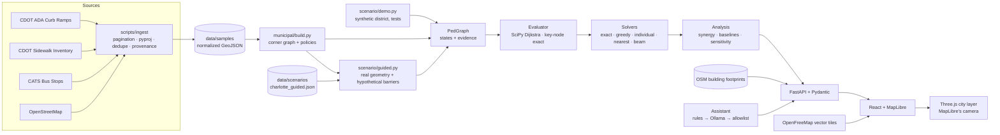

# Architecture




## Design principles

1. **The engine is the source of truth.** Every route, metric, ranking and explanation sentence is produced by deterministic code from the scenario graph and the applied-repair set.
2. **Unknown is not accessible.** Edges with missing evidence are `UNKNOWN` and excluded from modeled traversability. A separate sensitivity pass reports what would change if they were passable.
3. **Explicit topology.** Corners on different sides of a street are never connected directly; a crossing requires curb-ramp edges at both ends. The graph is undirected, so vehicle one-way rules never restrict pedestrians.
4. **Stateless evaluation.** The client sends the ordered list of applied repairs, and the server validates it (`RepairState`) and recomputes, so the map always reflects the engine and a server restart loses nothing. Undo restores the exact previous repair set (after an apply, a removal or a reset).
5. **AI is an interaction layer.** The assistant can only emit one of eleven allowlisted, typed operations. There is no code generation or execution, no free-form database query, and no file access.

## Module map (`services/api/streetmend`)

| Module | Responsibility |
|---|---|
| `graph/model.py` | `PedGraph`, `Node`, `Edge`, `Passability` (traversable/blocked/unknown), `Evidence` labels; traversable-subgraph view |
| `graph/algorithms.py` | Dijkstra routes (edge-exact geometry and length), reachability, reach wave, frontier barriers, components, Yen's k-shortest alternatives |
| `scenario/model.py` | `Scenario`, `Origin`, `Destination`, `Intervention`; validation (interventions only target non-traversable edges, no edge claimed twice) |
| `scenario/state.py` | `RepairState`: apply (idempotent), remove, undo, reset; the scenario graph is never mutated |
| `scenario/demo.py` | Synthetic Harbor District (test fixture): grid, corners, perpendicular curb ramps, crossings, places |
| `scenario/guided.py` | Guided scenario: the real Elizabeth graph with every link assumed traversable, plus the hypothetical barrier states and repair candidates from `data/scenarios/charlotte_guided.json` |
| `scenario/evaluate.py` | Map state for an applied set: effective edge states, journey route, reach wave, remaining blockers on the best repairable route |
| `optimize/objective.py` | Weighted reachable O-D objective; SciPy CSR evaluation; exact key-node evaluator; batched `score_many`; sound candidate pruning |
| `optimize/solvers.py` | Exact enumeration, greedy, independent ranking, beam search (seeded with exact sub-budget optima) |
| `optimize/analysis.py` | Full analysis: recommendation, baselines, synergy, leave-one-out marginals, new pairs, alternatives, sensitivity, template explanation |
| `municipal/build.py` | Charlotte graph builder and ramp passability policies |
| `municipal/scenario.py` | Loads prepared data, builds the three policy variants, serves source records |
| `ai/intents.py` · `rules.py` · `llm.py` · `executor.py` | Allowlist schema, offline rule parser, Ollama client with JSON-schema decoding and grounding check, operation registry |
| `api/` | FastAPI app, Pydantic contracts, registry, serialization, Markdown report; `/api/context/buildings` serves the footprint layer (gzip) |

## Exact fast evaluation

Repairs only *add* edges, so a shortest route in `G + S` that uses repaired edges enters the first repaired edge at some endpoint `a` and leaves the last one at endpoint `b`, with base-network shortest paths in between. With base distances `A` (origins→candidate endpoints), `B` (endpoints→destinations) and `K` (endpoints↔endpoints), computed once by one multi-source Dijkstra:

```
dist_S(o,d) = min( D0[o,d],  min_{a,b} A[o,a] + M*[a,b] + B[b,d] )
```

where `M*` is the Floyd–Warshall closure over only the endpoints of `S` (≤ 2|S| nodes) of `K` plus the repaired edges. Distances within the access threshold are exact; a truncated base distance can only hide paths longer than the threshold. Combinations are scored in vectorized batches over only the origin/destination pairs a repair could change. The test suite checks this against full Dijkstra for every subset of up to three repairs on the demo and on randomized networks, and against real Charlotte samples.

Sound pruning: a candidate that cannot lie on any within-threshold origin–destination path *even with every candidate repaired* has zero marginal value in every repair set, so exact enumeration over the remaining candidates is still exact.

Measured: the exact budget-2 search over Charlotte's 206 relevant strict-policy candidates (21,321 combinations) takes 3–5 s on this laptop depending on load; moderate policy, budget 2, 0.2–0.4 s (see `docs/BENCHMARK.md`). The batch kernel uses float64 so batch scores are identical to single-set scores, including at the threshold and in tie-breaking.

## Frontend (`apps/web`)

* `state/store.ts`: Zustand store. It holds the applied-repair stack (exact undo), parameters, evaluation and analysis, camera intents, the compare mode, presentation scenes and narration. Requests are sequenced, so a late response for an old state is dropped. Narration states only engine-verified facts: "neither repair completes this crossing alone" is shown only after extra evaluate calls confirm it.
* `App.tsx`: the map fills the main area and the planning panel floats over its right edge. Map chrome, camera framing (`fitCam`, `journeyCamera`), point offsets, labels and the before/after split all use the panel's width (`map/inset.ts`), so nothing important lands under it.
* `map/MapView.tsx`: MapLibre GL with a custom warm style on OpenFreeMap vector tiles (OpenMapTiles schema, no key). The 3D city layer sits below the street labels and the marker layer above them. Camera presets (overview, journey, crossing) use `cameraForBounds` and `easeTo`. The journey composition chooses a bearing so the destination recedes into the frame. Picking order is markers (screen space), then network edges, then buildings (ray cast in 3D).
* `intro/`: the opening.
  * `geo.ts` projects US state boundaries (us-atlas) into Web Mercator in MapLibre's own world units (a 512 px world at zoom 0).
  * `GeographicIntro.tsx` keeps a virtual camera. Until the regional scale it draws the outline on a canvas; then it drives the one MapLibre map with `jumpTo` every frame while the outline fades. Outline and map therefore never disagree about where Charlotte is.
  * The regional scales and the destination are rendered once while the outline still covers the map, so tiles, buildings and shadows are ready before the camera arrives.
  * The final frame is `journeyCamera`, the same composition as the Journey preset.
  * Time-based, skippable, shortened on return visits, motion-free under reduced motion, and it lands on a fallback camera if data never arrives.
* Building geometry is built time-sliced and its shaders are compiled with `compileAsync`, so no animation stalls on them.
* `map/three/CityLayer.ts`: the camera bridge. MapLibre hands each custom layer its projection matrix `P` and mercator view-projection `M`. The Three.js view matrix is `P⁻¹ · M · L`, where `L` maps local metres (east, up, south) around a fixed origin to mercator. Three.js therefore renders with exactly MapLibre's camera, and nothing is positioned with CSS. `alignmentReport()` compares the two projections; the E2E suite requires < 0.5 px at several pitches and bearings (measured error is about 1e-8 px). The layer also holds the sun (shadow map refreshed only when buildings change), the ground shadow catcher, and the scissored before/after split.
* `map/three/buildings.ts`: footprint extrusion (walls plus triangulated roofs, holes kept) merged into one mesh with per-vertex shading. A building index supports picking, tinting the destination building and the 2D/3D height animation.
* `map/three/network.ts`: the pedestrian network as screen-space fat lines (`LineSegments2`), one draw call per state category, plus the route (white halo, green core), the potential route and the reach wave. Every line is engine geometry.
* `map/three/markers.ts`, `icons.ts`: depth-tested, constant-size sprites. Repair states use glyphs as well as colour: bar = blocked, check = repaired, ? = unknown, letter = labeled candidate, dashed ring = hypothetical barrier.
* `map/MapLabels.tsx`, `map/CompareSlider.tsx`: DOM labels placed each frame from the same projection; the split handle is a keyboard-operable slider.
* `components/map/CrossingView3D.tsx`: a separate small Three.js renderer for the curb-ramp inspector. The geometry is conceptual and captioned as such; the ramp states come from the engine.
* `components/panel/`: the case story.
  * Journey card: headline, from/to, status "in model".
  * Plan view: "What would you repair?" with budget, priority, Advanced and the assistant.
  * Results view: the recommendation as an instruction, repairs with their real IDs, the measured effect, the before/after action, "why this combination", baselines, uncertainty and export.
  * Once every recommended repair is applied, the measured result moves to the top.
  * The explorer tabs: plan, records, data quality.
* Accessibility: every map fact is also in the panel (repairs can be located, applied and removed from the lists); keyboard-operable controls; `prefers-reduced-motion`; WCAG AA contrast, checked with axe in the E2E suite.

## Contrast with AskStreets

AskStreets (Adam Munawar Rahman) pioneered asking natural-language questions of OSMnx street graphs stored in ArangoDB, using a LangGraph ReAct agent that generates and runs AQL and NetworkX code. StreetMend takes inspiration from the natural-language framing but is independently designed for a different question: which *combination of repairs* to fund. It deliberately avoids LLM code generation so that every number can be audited, and it keeps the graph in NetworkX/SciPy because a graph database adds no defensible advantage at neighborhood scale.
