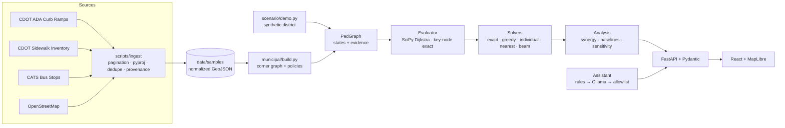

# Architecture




## Design principles

1. **The engine is the source of truth.** Every route, metric, ranking and explanation sentence is produced by deterministic code from the scenario graph and the applied-repair set.
2. **Unknown is not accessible.** Edges with missing evidence are `UNKNOWN` and excluded from modeled traversability. A separate sensitivity pass reports what would change if they were passable.
3. **Explicit topology.** Corners on different sides of a street are never connected directly; a crossing requires curb-ramp edges at both ends. The graph is undirected, so vehicle one-way rules never restrict pedestrians.
4. **Stateless evaluation.** The client sends the ordered list of applied repairs, and the server validates it (`RepairState`) and recomputes, so the map always reflects the engine and a server restart loses nothing. Undo restores the exact previous repair set (after an apply, a removal or a reset).
5. **AI is an interaction layer.** The assistant can only emit one of eleven allowlisted, typed operations. There is no code generation or execution, no free-form database query, and no file access.

## Module map (`services/api/streetmend`)

| Module | Responsibility |
|---|---|
| `graph/model.py` | `PedGraph`, `Node`, `Edge`, `Passability` (traversable/blocked/unknown), `Evidence` labels; traversable-subgraph view |
| `graph/algorithms.py` | Dijkstra routes (edge-exact geometry and length), reachability, reach wave, frontier barriers, components, Yen's k-shortest alternatives |
| `scenario/model.py` | `Scenario`, `Origin`, `Destination`, `Intervention`; validation (interventions only target non-traversable edges, no edge claimed twice) |
| `scenario/state.py` | `RepairState`: apply (idempotent), remove, undo, reset; the scenario graph is never mutated |
| `scenario/demo.py` | Synthetic Harbor District: grid, corners, perpendicular curb ramps, crossings, places, drawing-only context |
| `scenario/evaluate.py` | Map state for an applied set: effective edge states, journey route, reach wave, remaining blockers on the best repairable route |
| `optimize/objective.py` | Weighted reachable O-D objective; SciPy CSR evaluation; exact key-node evaluator; batched `score_many`; sound candidate pruning |
| `optimize/solvers.py` | Exact enumeration, greedy, independent ranking, beam search (seeded with exact sub-budget optima) |
| `optimize/analysis.py` | Full analysis: recommendation, baselines, synergy, leave-one-out marginals, new pairs, alternatives, sensitivity, template explanation |
| `municipal/build.py` | Charlotte graph builder and ramp passability policies |
| `municipal/scenario.py` | Loads prepared data, builds the three policy variants, serves source records |
| `ai/intents.py` · `rules.py` · `llm.py` · `executor.py` | Allowlist schema, offline rule parser, Ollama client with JSON-schema decoding and grounding check, operation registry |
| `api/` | FastAPI app, Pydantic contracts, registry, serialization, Markdown report |

## Exact fast evaluation

Repairs only *add* edges, so a shortest route in `G + S` that uses repaired edges enters the first repaired edge at some endpoint `a` and leaves the last one at endpoint `b`, with base-network shortest paths in between. With base distances `A` (origins→candidate endpoints), `B` (endpoints→destinations) and `K` (endpoints↔endpoints), computed once by one multi-source Dijkstra:

```
dist_S(o,d) = min( D0[o,d],  min_{a,b} A[o,a] + M*[a,b] + B[b,d] )
```

where `M*` is the Floyd–Warshall closure over only the endpoints of `S` (≤ 2|S| nodes) of `K` plus the repaired edges. Distances within the access threshold are exact; a truncated base distance can only hide paths longer than the threshold. Combinations are scored in vectorized batches over only the origin/destination pairs a repair could change. The test suite checks this against full Dijkstra for every subset of up to three repairs on the demo and on randomized networks, and against real Charlotte samples.

Sound pruning: a candidate that cannot lie on any within-threshold origin–destination path *even with every candidate repaired* has zero marginal value in every repair set, so exact enumeration over the remaining candidates is still exact.

Measured: the exact budget-2 search over Charlotte's 206 relevant strict-policy candidates (21,321 combinations) takes about 3 s; moderate policy, budget 2, about 0.2 s (see `docs/BENCHMARK.md`). The batch kernel uses float64 so batch scores are identical to single-set scores, including at the threshold and in tie-breaking.

## Frontend (`apps/web`)

* `state/store.ts`: Zustand store. It holds the applied stack, parameters, evaluation and analysis, auto re-analysis on parameter changes, and repair narration. Narration states only engine-verified facts: "neither alone" claims are re-checked with extra evaluate calls before display.
* `map/MapView.tsx`: MapLibre GL with WebGL line/circle layers for the network, records and inventory. A blank style is used for the synthetic district (fully offline) and the OpenFreeMap basemap for Charlotte. Reach-wave and route-trace animations are driven by backend distances and geometry, and respect `prefers-reduced-motion`.
* `map/Markers.tsx`: candidate repairs and places are real `<button>` elements with accessible names (keyboard focusable).
* `components/`: planning panel (question, budget, priorities, threshold, network condition, analysis, recommendations, synergy chart, baselines, evidence, export), Charlotte explorer (policy, records, data quality), methodology dialog.

## Contrast with AskStreets

AskStreets (Adam Munawar Rahman) pioneered asking natural-language questions of OSMnx street graphs stored in ArangoDB, using a LangGraph ReAct agent that generates and runs AQL and NetworkX code. StreetMend takes inspiration from the natural-language framing but is independently designed for a different question: which *combination of repairs* to fund. It deliberately avoids LLM code generation so that every number can be audited, and it keeps the graph in NetworkX/SciPy because a graph database adds no defensible advantage at neighborhood scale.
