# STREETMEND

**Understand the gap. Test the change. Restore access.**

StreetMend is an **urban access intelligence and infrastructure decision verification** tool for Charlotte, NC. One graph engine, running on the real pedestrian network of Elizabeth, answers four questions:

| | Question | What StreetMend does |
|---|---|---|
| **Discover** | Where is access failing? | Measures every home's distance to six kinds of essential service *along the pedestrian network*, per travel profile, as PASS / INCONCLUSIVE / FAIL |
| **Diagnose** | Why is it failing? | Separates a connectivity barrier, a network detour, a missing facility and missing data, and names the recorded barriers |
| **Intervene** | What could we change? | Compares repairing the network with building a hypothetical facility, on the same homes and the same objective |
| **Verify** | How do we know the change works? | Re-runs the checks on the recomputed network, and tests a *proposed* street change before it is made: PROPOSE → TEST → FIND BREAKAGE → GENERATE FIX → VERIFY |

Built for IEEE Hack for Humanity 2026, track *Geospatial Intelligence for Action*.

**Live demo: [streetmend.vercel.app](https://streetmend.vercel.app)** · **Pitch video: [docs/media/streetmend-pitch.mp4](docs/media/streetmend-pitch.mp4)**

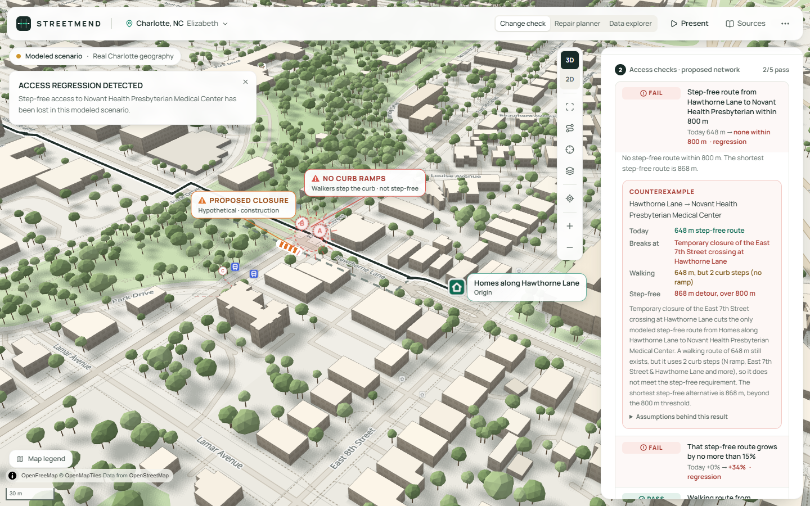

> Planning and research prototype. The checks are configurable planning checks on a modeled network: not a certified accessible-navigation system, not an ADA compliance determination, and not an authorization to conduct construction. The City of Charlotte has not reviewed or endorsed it. The change check uses hypothetical proposals and barriers on real streets; the access analysis uses real CDOT records, and its new-facility sites are hypothetical.

---

## The problem

Cities invest in infrastructure to improve access to clinics, schools, groceries and transit. But an area with poor access can have quite different problems:

* **Connectivity**: a facility is close, but a missing sidewalk or curb ramp cuts the route.
* **Service availability**: the network is connected, but no facility is within reach.
* **A change that breaks access**: a construction closure removes the last route someone had.

Each needs a different response. A new clinic will not fix a missing sidewalk, a repaired ramp will not create a grocery store, and a proposed closure should be tested before it is built. Straight-line access maps cannot tell these cases apart. On the Elizabeth data, straight-line distance places **522** more homes within reach of a school (step-free) than the network does.

The same change also affects people differently. Someone who can step a curb may still have a route; someone who needs a continuous step-free path may have lost their only one.

## What StreetMend does

### 1. Discover: access gaps on the real network

* **951 homes** (OSM residential buildings, a proxy and not population) in Elizabeth, each snapped to the nearest sidewalk.
* **Six service categories**, with REACH's set and walking thresholds: healthcare 1,500 m, education 1,200 m, grocery 800 m, transit 600 m, parks 1,000 m, essential services 1,000 m. Facilities come from OpenStreetMap, plus CATS bus stops.
* **Two travel profiles** on one graph. *Step-free*: a missing or failed curb ramp is a barrier. *Walking*: a curb can be stepped.
* **Three answers, kept apart**:
  * **PASS**: reachable using only links of known condition;
  * **INCONCLUSIVE**: reachable only if links of unknown condition are passable;
  * **FAIL**: not reachable in the modeled network.
* Results are aggregated into H3 cells (resolution 9) on the 3D map.

### 2. Diagnose: why access is poor

For a selected cell, the engine finds a typical home and reports four distances: straight line, walking route, step-free route, and the route with every modeled link open. Comparing them gives the dominant cause:

| Cause | Test | What it means |
|---|---|---|
| **Connectivity barrier** | with every link open, a route within the threshold exists, but the usable one is longer | Recorded barriers (for example *CDOT inventory: No Sidewalk*) cut it. Repairs can help. |
| **Network detour** | a facility is within the threshold in a straight line, but not along the network even with every link open | The street layout is the problem. |
| **No facility in reach** | nothing within the threshold even in a straight line | A service-availability gap. Repairs cannot close it. |
| **Unknown links** | reachable only through uninventoried links | A data gap. Verify the links before acting. |
| **Beyond study area** | the nearest facility lies outside the modeled network | Cannot be verified here. |

The diagnosis also lists the recorded barriers on the route (with their CDOT ids), the unknown links, and an **E2SFCA-style service supply index** after REACH. The supply index counts one unit per facility, because no capacity data exists.

### 3. Intervene: fix the network or build?

Both options are judged on the same homes, the same graph and the same declared objective: homes newly within the threshold.

* **Fix**: the best set of up to 1–3 repairs. Candidates are the 58 CDOT-recorded curb-ramp barriers and the 34 recorded sidewalk gaps. The search is exact over every repair that can lie on a route within the threshold (a network-ellipse test that can only over-include). Larger budgets use a labeled beam search.
* **Build**: one hypothetical facility at an existing non-residential building. These are real buildings, but land, zoning and cost are not assessed.

The winner comes from the computation, not a preset. A tie is reported as a tie, and costs are not compared.

### 4. Verify: test the change before you make it

The **change check** is the primary demo:

1. A planner **proposes** a typed, validated change (close or reopen a sidewalk, crossing or ramp) on a separate proposed network. Today's network is never modified.
2. StreetMend **tests** explicit access requirements on both networks:
   * a route within a threshold, per profile;
   * a detour limit;
   * access to a destination category;
   * a share of today's journeys kept.
3. It **finds the breakage**: a graph **counterexample** showing:
   * today's route and the exact edge the change removes;
   * the walking route that survives, and the curb steps that make it unusable step-free;
   * the shortest step-free alternative, and why it fails.
4. It **generates a fix**: an exact search, by increasing size, over a catalog of typed interventions, which respects dependencies and budgets. A set counts as a fix only when the recomputed network passes every regressed check without breaking another.
5. It **verifies**: the fix goes into a third network state and the checks run again. Switch an intervention off and they fail again.

Every intervention follows one model: id, type, target edges, state change, checked preconditions, travel profiles, cost units, dependencies, provenance, and whether it is record-backed or simulated. Road closures are listed as unsupported: there is no vehicular graph, so they are not faked.

### Ask in plain English

Questions such as *"Which neighborhood has the poorest access to groceries?"*, *"Is repairing better than adding a new school?"*, *"Show the streets that disconnect the most journeys if closed"* or *"Why did verification fail?"* are handled in three steps:

1. Each question maps to one of 18 allowlisted operations with typed arguments: rules first, then an optional local model (Qwen via Ollama). Anything else is "unsupported".
2. Deterministic graph tools compute the answer, and the answer drives the map.
3. Any sentence the model writes may only use numbers that appear in the computed facts.

No model-generated code or query is ever executed. The product works fully without the model.

### Kept from the original StreetMend

* **Repair planner**: the combination of repairs that reconnects the most journeys, compared with greedy and ranking baselines.
* **Data explorer**: 320 real CDOT curb-ramp records, the sidewalk inventory and CATS stops, with record-level detail and data-quality reporting.

## Measured results (computed, not asserted)

**Change check** (Elizabeth streets, hypothetical settings; re-derived in `services/api/tests/test_verify.py`):

* **Today**: homes on Hawthorne Lane have a **648 m** step-free route to Novant Health Presbyterian. All 5 checks pass.
* **The proposal**: a hypothetical closure of the East 7th Street crossing.
  * **3 checks fail**. Step-free journeys in the area drop from 55 to 44 of 84.
  * Walkers keep a 648 m route, but it steps **2 curbs** without ramps. The shortest step-free detour is **868 m**.
* **The fix**: the search checks 20 candidate sets in about 0.4 s and returns **A + B**, temporary ramps at both ends of the other crossing. Neither ramp alone works. A temporary crossing at Park Drive restores a 774 m route, but it is a +19% detour.
* **Verified**: with A + B in place, all 5 checks pass and all 55 journeys are back. Switching B off fails the checks again.

**Fix or build** (real records; `services/api/tests/test_access.py`), for 51 homes in south-east Elizabeth that cannot reach a school step-free:

| Option | Budget 1 | Budget 2 |
|---|---|---|
| Fix | +32 homes (one sidewalk gap built) | **+42**: two gaps, one of them worth **0** on its own |
| Build | **+35** (a hypothetical school site) | +35 |
| Winner | **build** | **fix** |

* **Grocery**: no supermarket lies inside the modeled network and 574 homes fail. Repairs cannot help, and a hypothetical store reaches 42 of 81 homes in the worst cell.

**Data honesty**: healthcare within 1,500 m step-free gives:

* **197** homes PASS on known links;
* **754** INCONCLUSIVE, because their routes use sidewalks with no CDOT inventory record;
* **0** FAIL.

StreetMend will not call the inconclusive ones served.

**Evaluation** ([docs/EVALUATION.md](docs/EVALUATION.md), generated by `scripts/benchmarks/run_evaluation.py`):

* **10 of 10 deterministic fixtures fully correct**: single bottleneck, dependent pair, existing alternative, multiple destinations, infeasible budget, unknown state, two requirements, redundant candidates, no mitigation, and detour limit. For each:
  * counterexamples are re-checked independently;
  * every fix is re-verified;
  * every member of every fix is shown to be necessary.
* **Greedy fails** both dependent-pair cases, including Charlotte.
* **Nearest-first** matches the exact search in several cases, including Charlotte; the report shows where.

## Screenshots

| Access gaps: where it fails | Diagnose: a connectivity barrier | Fix or build, same objective |
|---|---|---|
| 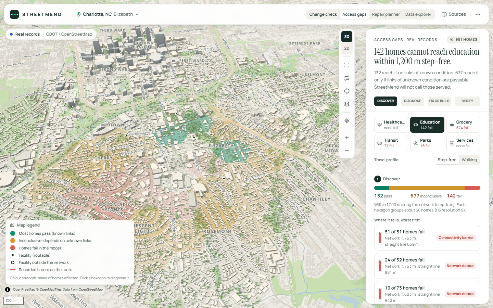 | 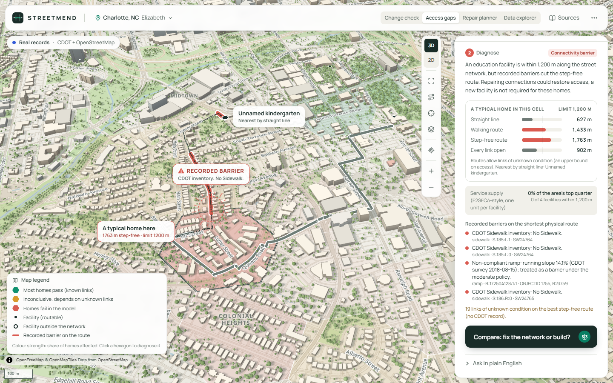 | 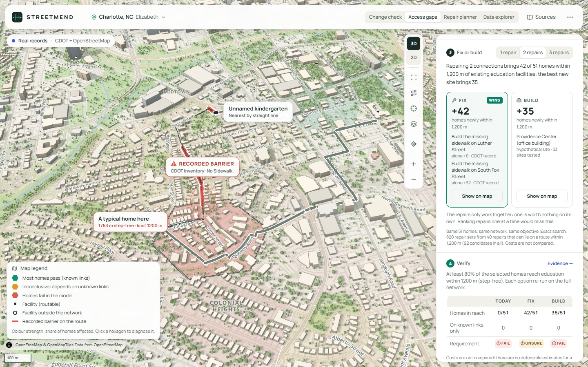 |
| **The fix, re-verified on the map** | **Budget one: building wins** | **Grocery: repairs cannot help** |
| 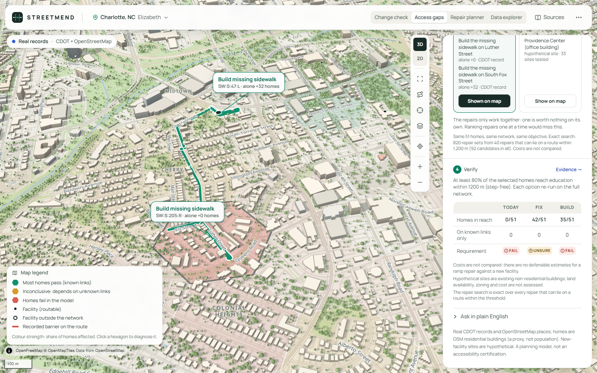 | 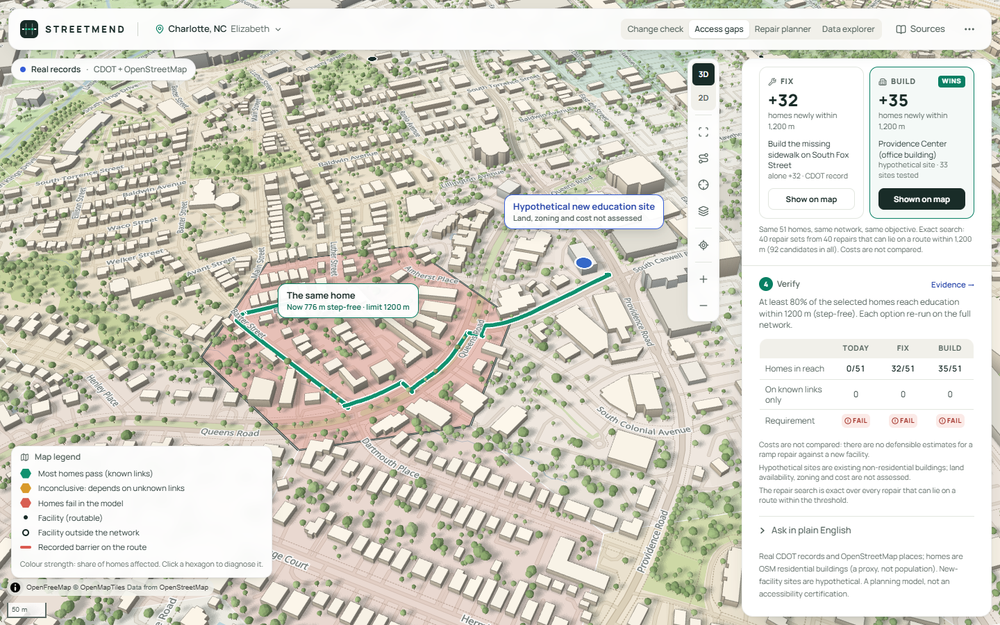 | 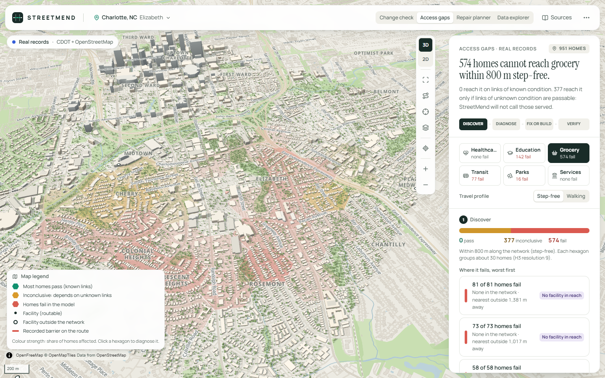 |
| **Change check: the regression** | **Same change, two travel profiles** | **Minimal fix, and why not fewer** |
|  | 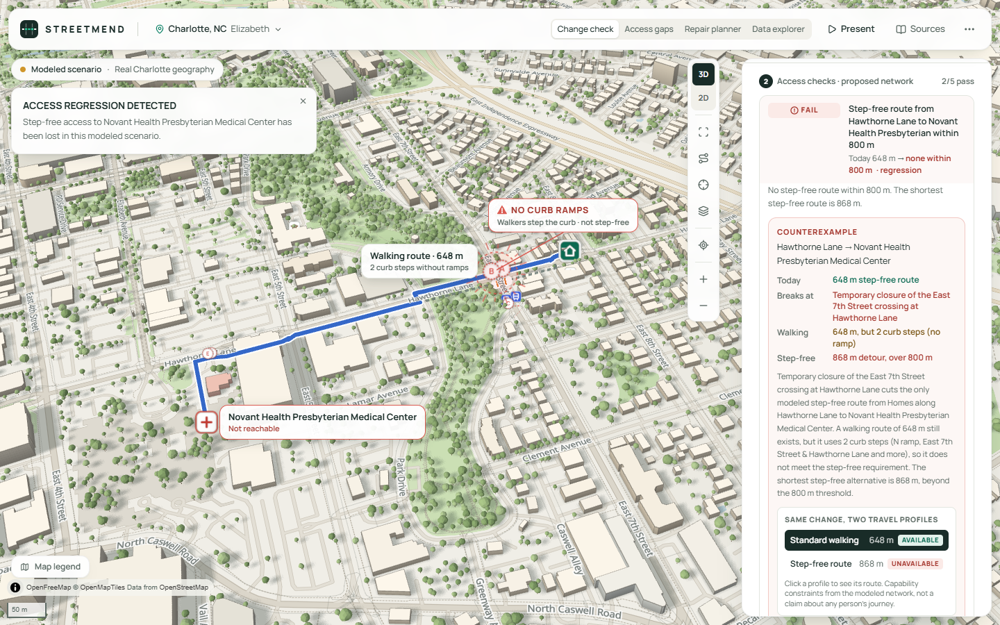 | 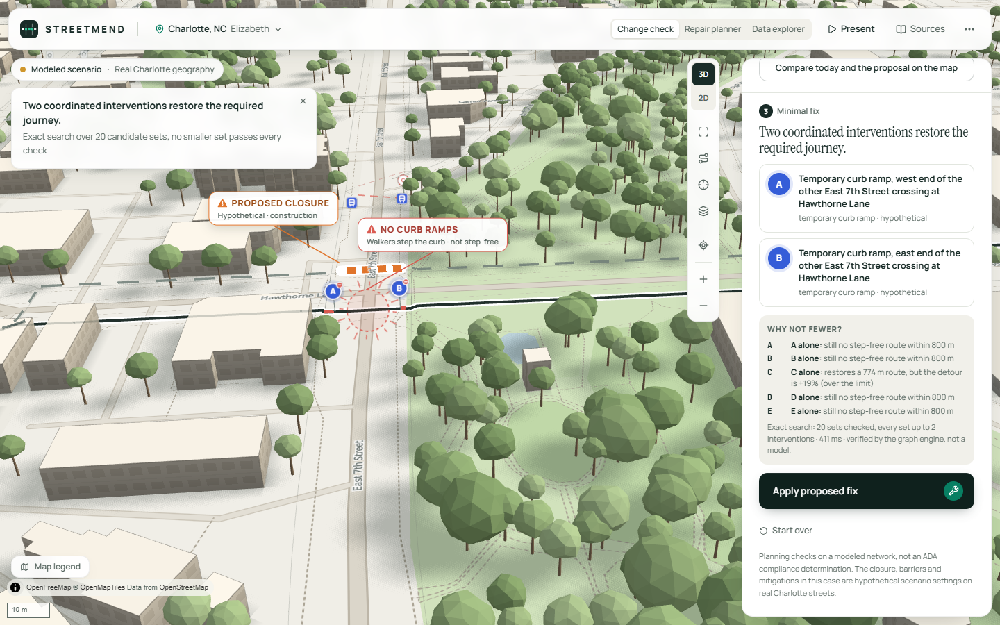 |
| **Applied and verified** | **Evidence in the app** | **The opening: United States → Charlotte** |
| 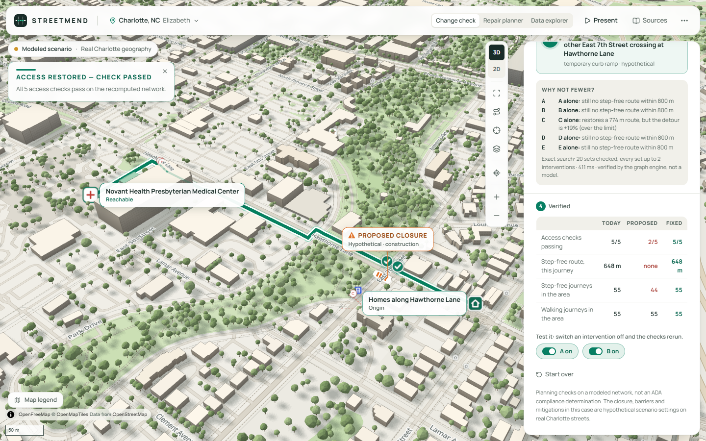 | 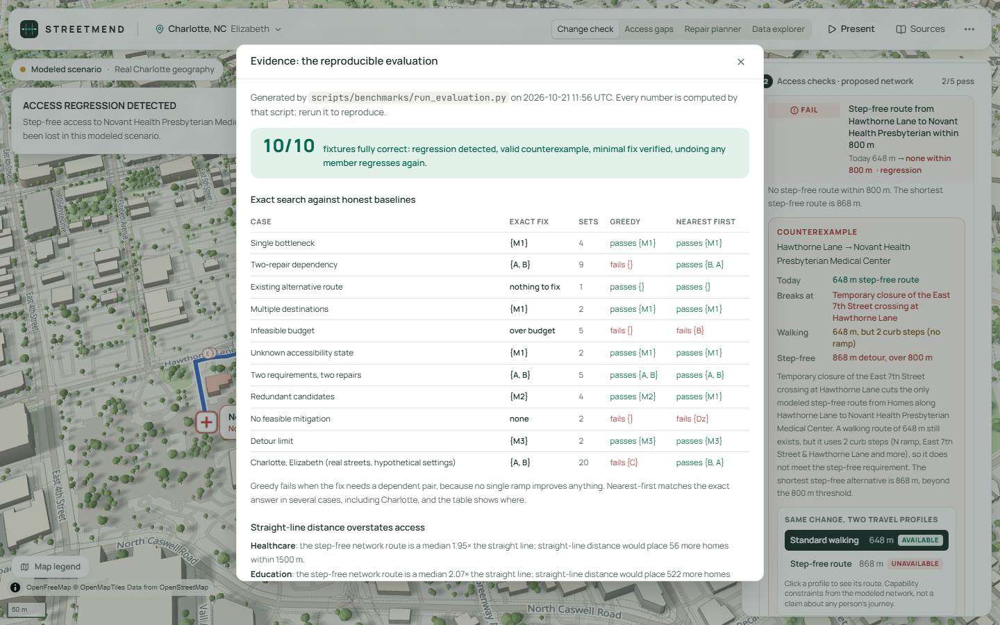 | 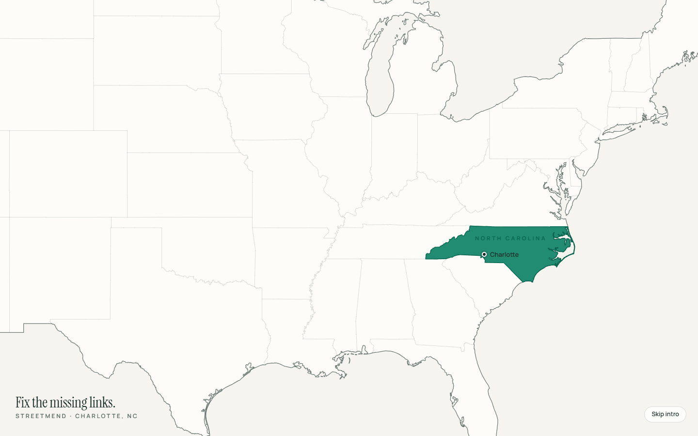 |

More: [repair planner](screenshots/05-recommendation.png) · [a real CDOT record](screenshots/11-explorer-record.png) · [3D city](screenshots/04-city-3d.png) · [heal effect](screenshots/15-heal.png) · [phone](screenshots/13-mobile.png)

**Pitch video (2.5 min, narrated, subtitled):** [docs/media/streetmend-pitch.mp4](docs/media/streetmend-pitch.mp4). It covers the hook, the problem (Geospatial Intelligence for Action), the change check and access gaps shown on the real app, and the evidence. The app footage is a real capture driven by Playwright; the narration is generated locally (Kokoro).

Screen-capture demo: [docs/media/streetmend-demo.mp4](docs/media/streetmend-demo.mp4).

## Architecture

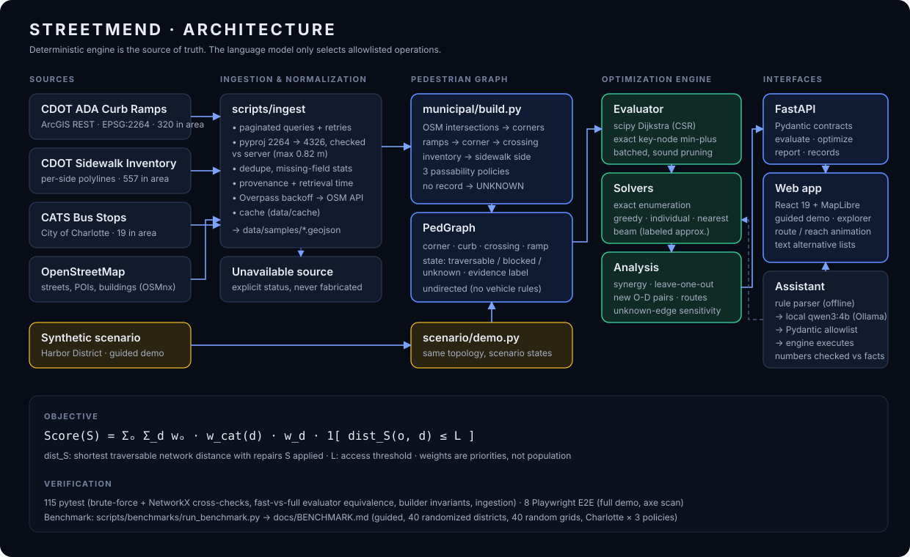

* **Engine** (`services/api/streetmend`), in Python:
  * `graph`: pedestrian graph with explicit edge states and evidence;
  * `verify`: typed changes, travel profiles, three-valued checks, counterexamples, minimal-fix synthesis and the intervention model;
  * `access`: network distances, diagnosis, the E2SFCA-style supply index and fix-or-build;
  * `optimize`: the repair planner;
  * `evaluation`: benchmark fixtures and baselines;
  * `ai`: the allowlisted operations.
* **Libraries**: NetworkX for routes, SciPy compiled Dijkstra for batches, Shapely for snapping, H3 for cells.
* **API**: FastAPI with Pydantic contracts.
* **Web** (`apps/web`):
  * React 19, TypeScript, Tailwind CSS v4;
  * MapLibre GL JS with a Three.js custom layer (the 3D city) on OpenFreeMap tiles;
  * Zustand and Motion.

Details: [ARCHITECTURE.md](ARCHITECTURE.md) · Method: [METHODOLOGY.md](METHODOLOGY.md) · Data: [DATA_SOURCES.md](DATA_SOURCES.md) · Limits: [LIMITATIONS.md](LIMITATIONS.md) · Related work: [docs/COMPARISON.md](docs/COMPARISON.md)

## Run it

Requirements: Python 3.12+ with [uv](https://docs.astral.sh/uv/), Node.js 20+, and a WebGL2 browser. Optional: [Ollama](https://ollama.com) with `qwen3:4b`, used as a language-model fallback for the question box.

```bash
# 1. API (from the repo root)
cd services/api
uv sync
uv run uvicorn streetmend.api.main:app --port 8000
```

```bash
# 2. Web app (second terminal, from the repo root)
cd apps/web
npm install
npm run dev
```

On Windows you can start both at once with `powershell -ExecutionPolicy Bypass -File scripts/dev.ps1`.

**Hosted:** the same app runs on Vercel at https://streetmend.vercel.app. The React app is served as static files; the FastAPI engine runs as one Python function (`api/index.py`, `vercel.json`, `requirements.txt`). The first request after a quiet spell takes a few seconds while the engine loads the Charlotte network. The hosted copy has no local language model, so plain-English questions use the rule parser.

Open http://localhost:5173. The app opens on the **Change check**. Switch to **Access gaps** in the header for discover → diagnose → fix or build → verify.

All prepared data is committed under `data/`, so the engine needs no network access: the Charlotte network, facilities, building footprints and scenario specs. Basemap tiles load from OpenFreeMap. Offline, the buildings, network, routes and checks still work on a plain background.

### Re-fetch the data (optional)

```bash
uv run --project services/api --extra ingest python scripts/ingest/fetch_charlotte.py --refresh
uv run --project services/api python scripts/ingest/fetch_facilities.py
uv run --project services/api --extra ingest python scripts/ingest/fetch_buildings.py
uv run --project services/api --extra ingest python scripts/ingest/fetch_trees.py
```

## Demo

Follow [DEMO_SCRIPT.md](DEMO_SCRIPT.md).

**Primary demo (about 100 s)**: the change check. **Present** runs six acts on the live engine:

1. A city that works.
2. A planner proposes a change.
3. **ACCESS REGRESSION DETECTED**, with the counterexample and the walking vs step-free comparison.
4. "Two coordinated interventions restore the required journey".
5. **ACCESS RESTORED — CHECK PASSED**.
6. Switch B off and back on.

**Secondary demo (about 60 s)**: Access gaps → Education → the worst cell, then:

1. **Diagnose**: a connectivity barrier.
2. **Compare: fix the network or build?** With two repairs, fixing wins.
3. Switch the budget to 1 repair: building wins.
4. Show either option on the map to see the re-verified route.
5. **Grocery**: repairs cannot help.

## Tests

```bash
cd services/api && uv run pytest          # 170 tests (see below)
cd apps/web && npx playwright test        # 19 end-to-end tests against the real API
cd apps/web && GPU=1 npx playwright test  # the same, rendering the 3D city on the real GPU (faster; the software renderer can time out on a busy machine)
uv run --project services/api python scripts/benchmarks/run_evaluation.py   # regenerates docs/EVALUATION.md
uv run --project services/api python scripts/benchmarks/run_benchmark.py    # regenerates docs/BENCHMARK.md (repair planner)
```

The Python suite covers:

* **Change check, act by act**: A + B is the only minimal fix, and every alternative is re-checked independently.
* **Three-valued logic**: unknown is INCONCLUSIVE, never PASS. This includes a regression test for a real bug the evaluation found: a cache keyed by `id()`, which Python reuses.
* **Intervention model**: types, preconditions, dependency cycles, and budgets that report infeasibility.
* **Benchmark fixtures**: all 10.
* **Access analysis**:
  * distance states are ordered (verified ≥ possible ≥ every-link-open ≥ straight line);
  * diagnoses are consistent with the distances;
  * walking is never worse than step-free;
  * the E2SFCA conservation property holds;
  * fix-or-build flips with the budget;
  * a brute force over every repair confirms the pruning drops nothing useful.
* **Street-intelligence operations** through the API.
* **The original repair planner and data pipeline**: exact search vs brute force, the fast evaluator vs full Dijkstra, builder invariants and ingestion.

The Playwright suite drives two flows end to end and compares every number with the API's answers:

* the **change check**: the counterexample, the two profiles, the fix and the toggle;
* **access gaps**: the diagnosis, fix or build, the budget flip, re-verification and the grocery case.

It also covers:

* the six presentation acts;
* the repair planner's 20-step flow;
* 3D/basemap alignment within 0.5 px;
* the opening;
* keyboard use and the phone layout;
* axe accessibility scans.

## Repository layout

```
services/api/streetmend/   graph · verify (changes, checks, interventions, synthesis) · access (analysis, diagnosis, fix or build)
                           optimize (repair planner) · evaluation (fixtures, baselines) · ai (allowlisted tools) · api
apps/web/src/              React UI: components/panel (ChangeCheck, AccessPanel), map (MapLibre + Three.js city, access layers)
data/samples/              Prepared Charlotte data: CDOT records, OSM network and facilities, building footprints, provenance
data/scenarios/            Change-check and repair-planner scenario specs (hypothetical settings on real streets)
scripts/ingest/            Reproducible Charlotte, OSM facility, building and canopy ingestion
scripts/benchmarks/        run_evaluation.py (docs/EVALUATION.md) and run_benchmark.py (docs/BENCHMARK.md)
docs/                      Evaluation, benchmark, comparison with related projects, architecture diagram, demo video
```

## Credits and attribution

* **REACH** by **Mohammad Umar** ([github.com/Mohammad-Umar7/reach](https://github.com/Mohammad-Umar7/reach)), a facility-siting tool for Abu Dhabi. StreetMend reuses its six service categories, walking thresholds, linear access score and E2SFCA supply design, re-implemented in Python on network distance rather than straight-line distance. No REACH code or data is used. REACH has no license file, so nothing was copied, and its synthetic parcel coordinates were not carried over.
* **AskStreets** by **Adam Munawar Rahman** ([github.com/msradam/askstreets](https://github.com/msradam/askstreets)) inspired asking natural-language questions of a street graph. StreetMend's version maps questions to typed, allowlisted tools and never executes generated code or queries. No AskStreets code is used.
* **Data**:
  * Charlotte Department of Transportation: ADA Curb Ramps and the Sidewalk Inventory. CATS / City of Charlotte: bus stops.
  * **OpenStreetMap contributors** (ODbL 1.0): the street network, facilities and building footprints. Basemap © OpenMapTiles, served by OpenFreeMap.
* **Method**: E2SFCA after Luo & Qi (2009).
* **Libraries**: NetworkX, SciPy, NumPy, Shapely, pyproj, h3, OSMnx, GeoPandas, FastAPI, Pydantic, React, MapLibre GL JS, three.js, Tailwind CSS, Motion, Zustand, lucide-react, Playwright and axe-core.

Code: MIT (see [LICENSE](LICENSE)). Data files keep their source licenses.

## Roadmap (not implemented)

* **Emergency road access**: a drivable graph with one-way and turn restrictions, so road closures can be checked like sidewalk closures.
* **Field verification** to turn UNKNOWN links into evidence (most step-free uncertainty here comes from uninventoried sidewalks).
* **Cost-aware budgets** once credible estimates exist. The CDOT `ActualCosts` field is empty for all 320 study-area records.
* **Population-weighted homes** from census data; facility capacity data for the supply index.
* **Citywide processing** with tiled graph builds.
