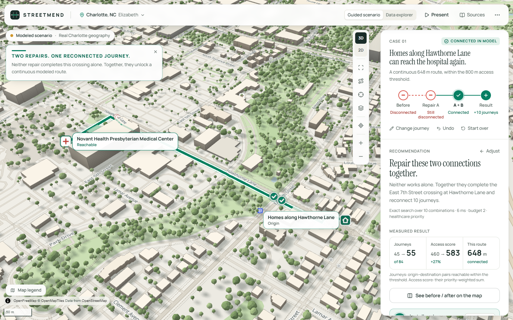
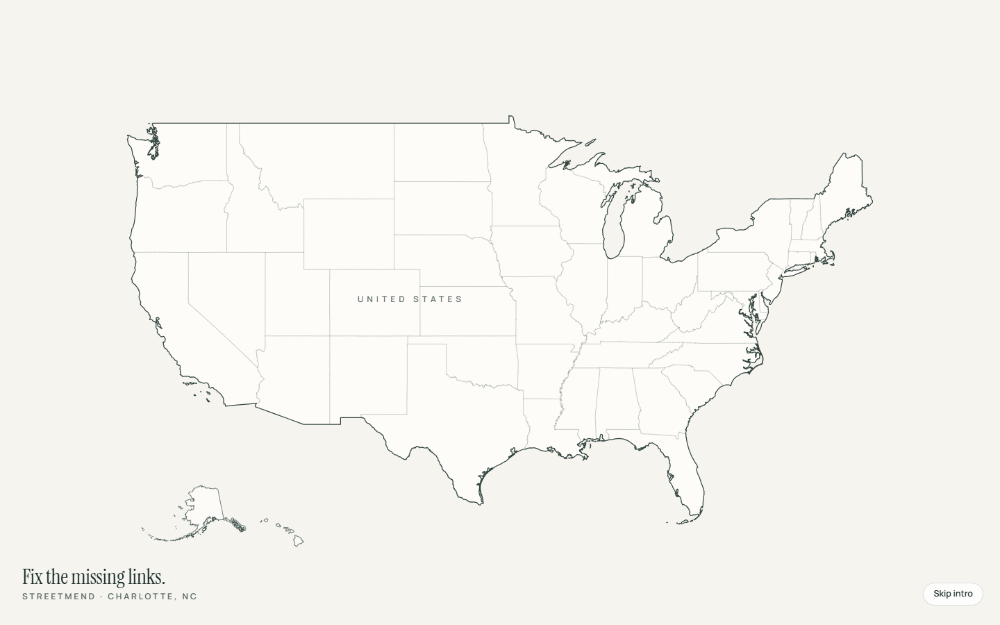
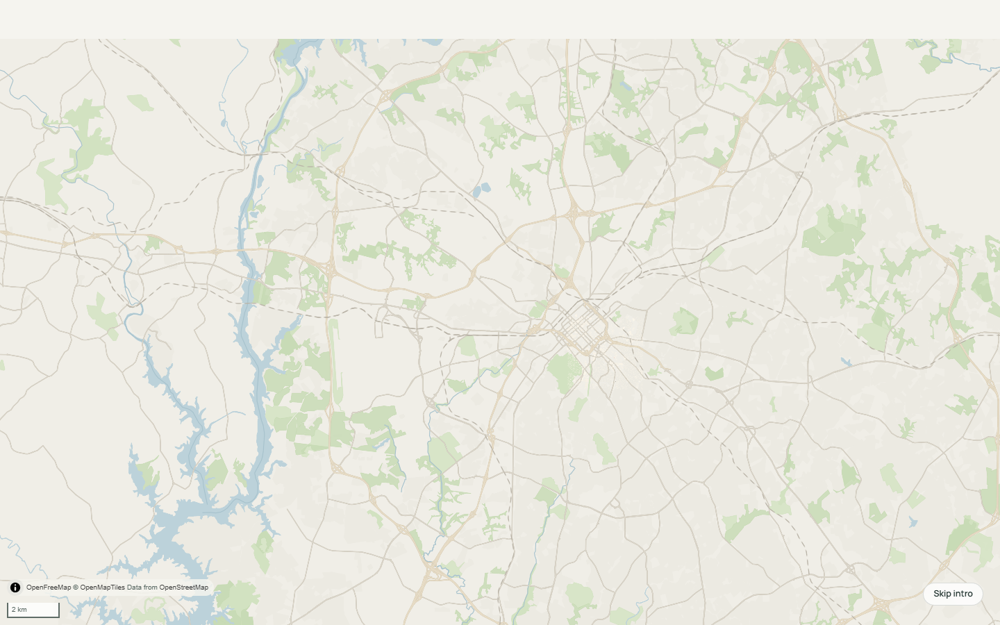
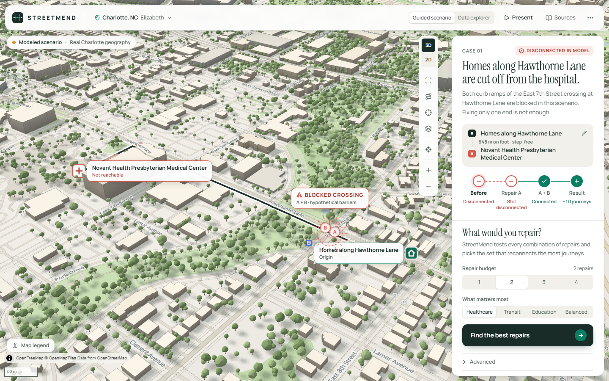
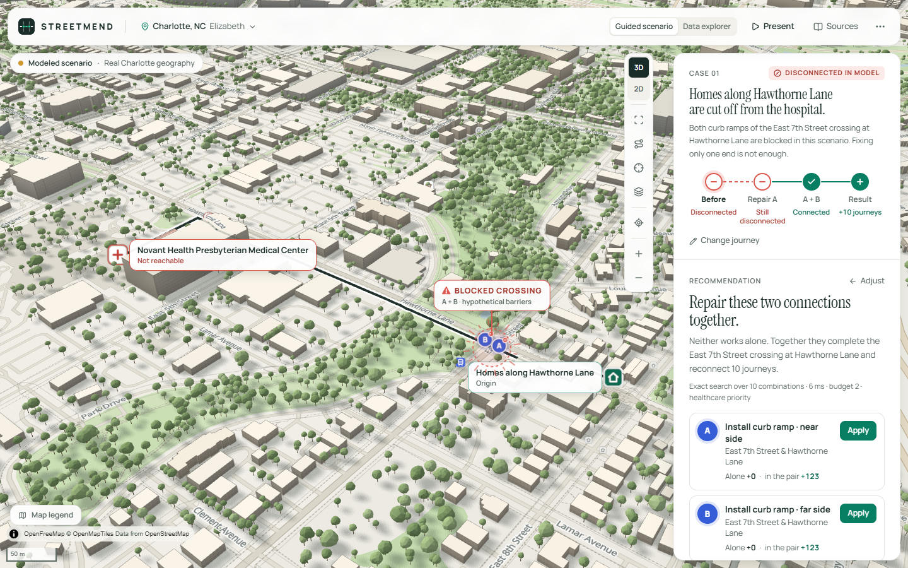
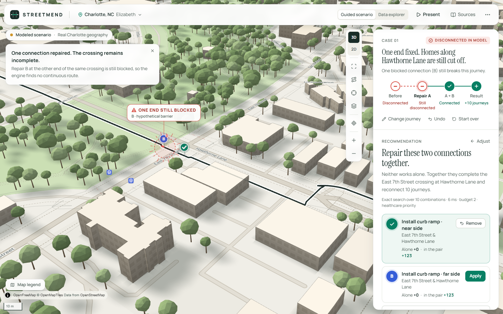
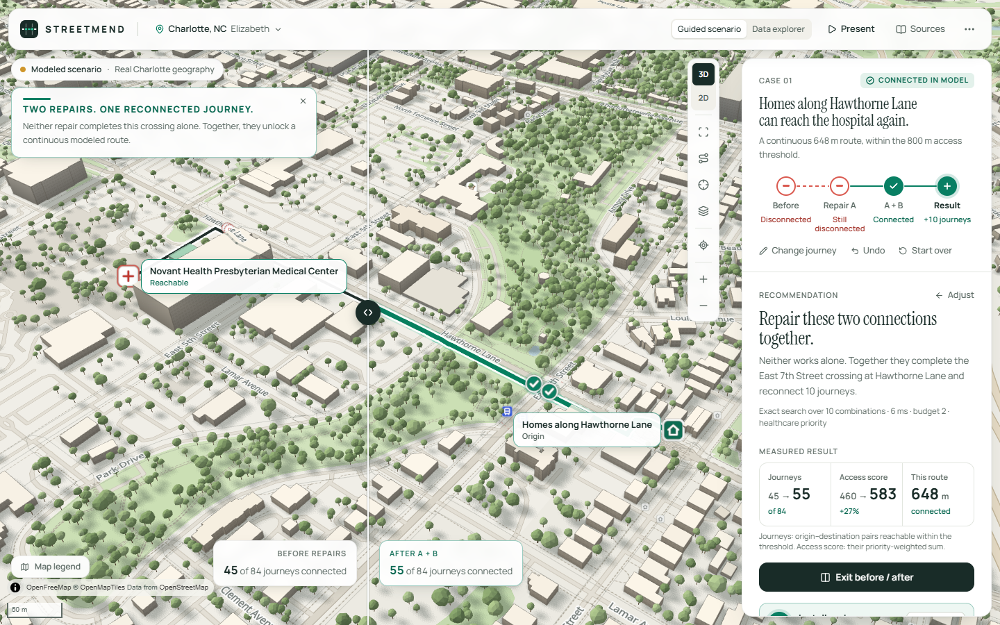
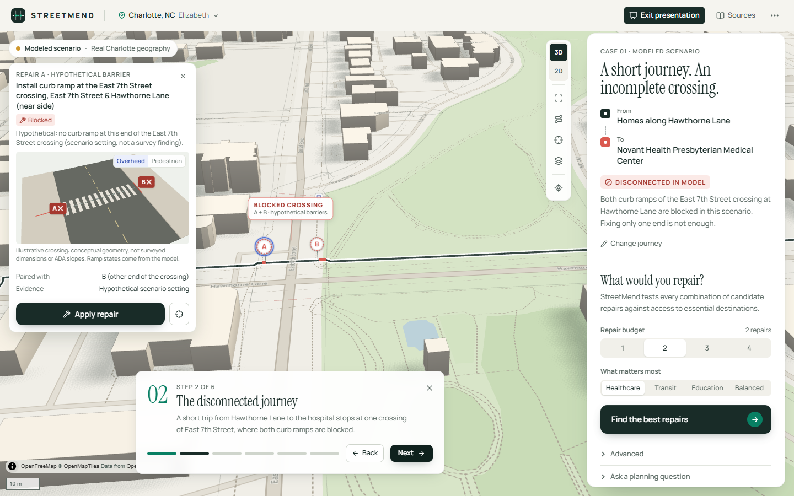

# STREETMEND

**Fix the missing links. Reconnect the city.**

StreetMend is a geospatial decision-support tool for pedestrian accessibility repairs. It models a street network as a graph of sidewalk corners, curb-ramp landings and crossings, simulates repairs, and recommends the **combination** of repairs that reconnects the most weighted journeys to essential services under a limited budget. Results are shown on a real map of Charlotte, NC, in 2D or as a 3D city built from OpenStreetMap building footprints.

Built for IEEE Hack for Humanity 2026, track *Geospatial Intelligence for Action*.



> Planning and research prototype. Not a certified accessible-navigation system, not an ADA compliance determination, and not an authorization to conduct construction. The City of Charlotte has not reviewed or endorsed it.

---

## The problem

A wheelchair user can cross a street only if the curb ramps at **both** ends of the crossing are usable. Ranking barriers one at a time misses this. Repairing one missing ramp may change nothing, while repairing it together with the ramp across the street opens a whole route.

So the planning question is not "which ramp is worst?" but:

> *Given a limited number of repairs, which combination produces the greatest measurable improvement in access to essential destinations?*

## What StreetMend does

| | |
|---|---|
| **Pedestrian graph** | Corners, curb landings, crossings and sidewalk sides. Every edge has an explicit state (traversable / blocked / unknown) and an evidence label (synthetic, municipal record, historical survey, OSM, inferred, assumed). Corners on different sides of a street connect only through a crossing with ramps at both ends. |
| **Combination-aware optimization** | Exact enumeration of every repair set within the budget (optimal for the stated candidate set and objective), plus greedy, individual-ranking and nearest-to-destination baselines. Beam search for very large candidate sets, always labeled approximate. |
| **Evidence, not decoration** | Every route on the map is a real graph path and every number comes from the engine. Synergy is measured explicitly: each repair's gain alone, its marginal value within the set, and newly connected origin–destination pairs. |
| **Real Charlotte map, 2D and 3D** | A warm atlas basemap (OpenFreeMap, no API key) with a Three.js layer that shares MapLibre's camera exactly: 5,113 OSM building footprints as an architectural massing model with sun shadows, and a tree canopy of 55,807 trees: 4,300 mapped trees at their real positions, the rest matching the City's 2022 canopy share per area. The network stays quiet context; only the selected journey (deep green), where it breaks (coral) and the computed route (emerald) carry colour. Camera presets, a 2D precision view, a before/after split on the same view, an illustrative 3D curb-ramp inspector, and a USA → Charlotte opening on first visit. |
| **Two operating modes** | **Guided scenario**: real Elizabeth streets with *hypothetical* barrier states, set up to show the dependent-repair problem, plus a six-step presentation mode. **Charlotte Data Explorer**: real CDOT curb-ramp and sidewalk records, CATS bus stops and OpenStreetMap streets/destinations, with record-level detail and data-quality reporting. |
| **Natural-language questions** | "Which two repairs improve access to healthcare the most?" A deterministic rule parser handles common phrasing; unrecognized phrasing can go to a local model (Ollama, `qwen3:4b`) that may only choose one allowlisted operation with validated arguments. The model never computes routes or scores; optional model wording is rejected if it contains any number or magnitude word not in the computed facts. |

### Why combinations matter (measured, not asserted)

* **Guided scenario** (healthcare priority, budget 2): the East 7th Street crossing at Hawthorne Lane has hypothetical barriers at both curb ramps. Repairs A and B are each worth **0** alone and **+123** together (objective 460 → 583, 10 journeys reconnected, a 648 m route to Novant Health Presbyterian). Greedy and individual ranking recommend nothing; with a budget of one, no repair helps. The barrier states were chosen to show the effect, so this is not evidence of typical gains.
* **Real Charlotte records** (moderate policy): homes along East 5th Street cannot reach Novant Health Presbyterian Medical Center within 800 m. Two recorded barrier ramps block the route, **R112391** and **R20741**; neither repair alone restores it. With both repaired, the route is 775 m.
* **Charlotte, strict policy, budget 2: exact +186 vs greedy +53.** Under the moderate and lenient policies, greedy already matches the optimum.
* 40 randomized districts: greedy is optimal in most instances (mean 97% of optimum, worst 32%). 40 unstructured grids: greedy falls below the optimum in 20–26% of instances.

Full tables: [docs/BENCHMARK.md](docs/BENCHMARK.md). The honest conclusion: simple ranking is often fine, but it fails badly exactly when value exists only in combination, and StreetMend detects and explains those cases.

## Screenshots

The case panel tells the story in four steps, each computed by the engine and clickable: **Before** (disconnected) → **Repair A** (still disconnected) → **A + B** (connected) → **Result** (+10 journeys, shown before/after on the map).

The opening flies from the United States to North Carolina, Charlotte and the Elizabeth study area: one continuous camera from a national outline (US Census boundaries) into the real map and the 3D city.

| United States | North Carolina | Charlotte |
|---|---|---|
|  |  |  |
| **Elizabeth in 3D: the case** | **Recommendation: A + B** | **Repair A alone: one end still blocked** |
|  |  |  |
| **Repair B: route reconnected** | **Before / after on one view** | **Presentation mode** |
|  |  |  |

More: [the heal effect when a repair lands](screenshots/15-heal.png) · [Elizabeth and Uptown in 3D](screenshots/10-city-wide.png) · [a real CDOT record](screenshots/11-explorer-record.png) · [data quality](screenshots/12-explorer-quality.png) · [phone](screenshots/13-mobile.png) · [phone case sheet](screenshots/14-mobile-case.png) · [before/after the redesign](docs/media/redesign-before-after.png)

A 100-second screen capture of the working app is in [docs/media/streetmend-demo.mp4](docs/media/streetmend-demo.mp4); the opening alone is [docs/media/streetmend-intro.mp4](docs/media/streetmend-intro.mp4). Both were recorded with Playwright driving the real UI against the real engine (no mock data), rendered on the laptop GPU, on a cold first visit (tile downloads included).

## Architecture


* **Engine** (`services/api/streetmend`): Python, NetworkX for routing/inspection, SciPy compiled Dijkstra for batch evaluation, an exact key-node evaluator for fast combination scoring, Shapely/pyproj for geometry.
* **API**: FastAPI with Pydantic request/response models.
* **Web** (`apps/web`): React 19, TypeScript, Tailwind CSS v4, MapLibre GL JS with a Three.js custom layer, d3-geo + us-atlas for the opening, Motion, Zustand. Type: Manrope and Instrument Serif.
* **AI**: rule parser plus an optional Ollama model behind a Pydantic allowlist; grounding check on any model-written sentence (standalone numbers, number words and magnitude words must appear in the computed facts).

Details: [ARCHITECTURE.md](ARCHITECTURE.md) · Method: [METHODOLOGY.md](METHODOLOGY.md) · Data: [DATA_SOURCES.md](DATA_SOURCES.md) · Limits: [LIMITATIONS.md](LIMITATIONS.md)

## Run it

Requirements: Python 3.12+ with [uv](https://docs.astral.sh/uv/), Node.js 20+, a WebGL2 browser. Optional: [Ollama](https://ollama.com) with `qwen3:4b` for the language-model fallback.

```bash
# 1. API (from the repo root)
cd services/api
uv sync
uv run uvicorn streetmend.api.main:app --port 8000
```

```bash
# 2. Web app (second terminal, from the repo root)
cd apps/web
npm install
npm run dev
```

On Windows you can start both at once with `powershell -ExecutionPolicy Bypass -File scripts/dev.ps1`.

Open http://localhost:5173. The Charlotte network data, the guided-scenario spec and the building footprints are committed under `data/`, so the engine needs no network access. The basemap tiles and label fonts load from OpenFreeMap; offline, the 3D buildings, network, routes and markers still render on a plain background.

Without Ollama, the assistant runs on the rule parser only. To use a different model or endpoint, see [.env.example](.env.example).

### Re-fetch the data (optional)

```bash
uv run --project services/api --extra ingest python scripts/ingest/fetch_charlotte.py --refresh
uv run --project services/api --extra ingest python scripts/ingest/fetch_buildings.py
uv run --project services/api --extra ingest python scripts/ingest/fetch_trees.py
```

## Demo

Follow [DEMO_SCRIPT.md](DEMO_SCRIPT.md) for the 90–120 second live demo. On a first visit the app opens with a 4-second flight from the United States to Elizabeth (skip with Esc; replay from the ⋯ menu). **Present** in the header then runs the story in six steps, on the live engine:

1. **The city**: Elizabeth, Charlotte: real streets and building footprints; the barriers in this scenario are hypothetical.
2. **The disconnected journey**: Hawthorne Lane to Novant Health Presbyterian stops at one crossing of East 7th Street; both curb ramps are blocked.
3. **The repair recommendation**: budget two; the engine evaluates every combination and selects A + B.
4. **The first intervention**: Repair A alone; one end is fixed, the journey is still broken.
5. **The second intervention**: Repair B; the route is traced through the street graph: **TWO REPAIRS. ONE RECONNECTED JOURNEY.**
6. **The measured result**: before/after on one view; A alone +0, B alone +0, together +123; baselines.

## Tests

```bash
cd services/api && uv run pytest          # 121 tests: engine, optimizer, guided scenario, API, assistant, municipal builder, ingestion
cd apps/web && npx playwright test        # 15 E2E tests against the real API (see below)
uv run --project services/api python scripts/benchmarks/run_benchmark.py   # regenerates docs/BENCHMARK.md
```

The Python suite covers:
* Exact search against brute force (NetworkX reference).
* The fast evaluator against full Dijkstra on every subset.
* The dependent-pair synergy case, on the synthetic district and on the guided scenario.
* Unknown edges excluded from traversability, plus budget limits, undo/reset, and determinism.
* Builder invariants (no direct corner-to-corner links, WGS84 bounds, candidates only from recorded barrier ramps).
* Ingestion pagination, reprojection and failure handling.

The Playwright suite runs the full 20-step flow:
1. Open the Charlotte map, switch 2D/3D, rotate and zoom.
2. Select the journey and inspect the blocked crossing from its map marker.
3. Analyze with a budget of two.
4. Apply A (still disconnected), then B (reconnected); the route length is checked against `/evaluate`.
5. Use the before/after split, undo, and reset.
6. Open a real CDOT record and check it field-by-field against `/municipal/records`.
7. Return to the guided scenario.

It also checks:
* The Three.js and MapLibre projections agree within 0.5 px at several pitches, bearings and zooms.
* A budget of one recommends nothing.
* The six presentation steps, the assistant allowlist and keyboard operation.
* The explorer's real-data dependency and policy switch.
* The phone layout.
* axe scans with no serious or critical findings.
* The opening:
  * the highlighted state's geometry contains Charlotte and Raleigh, not Columbia SC or Richmond VA;
  * the flight lands on the study area in 3D, with the city aligned;
  * skip and replay work;
  * a return visit gets the short version, and reduced motion gets no movement.

## Repository layout

```
apps/web/              React + MapLibre + Three.js frontend, Playwright E2E (e2e/), capture, axe and demo-recording scripts
  src/map/three/       3D city layer: camera bridge, footprint extrusion, network lines, marker sprites
  src/intro/           USA → Charlotte opening: national geometry and the camera timeline
services/api/          Python package `streetmend`: graph, scenario, optimize, municipal, ai, api + pytest suite
data/samples/          Prepared Charlotte (Elizabeth) study-area data and city building footprints, with provenance
data/scenarios/        Guided-scenario spec (hypothetical barrier states on real streets)
scripts/ingest/        Reproducible Charlotte, OSM and building ingestion
scripts/scenarios/     Designer that searched the real graph for the guided scenario's dependent pair
scripts/benchmarks/    Benchmark generating docs/BENCHMARK.md
docs/                  Architecture diagram, benchmark, demo video
screenshots/           README screenshots
```

## Roadmap (not implemented)

* Field-verification workflow to turn UNKNOWN links into evidence.
* Cost-aware budgets once credible per-ramp cost estimates exist (the CDOT `ActualCosts` field is empty for all 320 study-area records).
* Signal timing and crossing-risk modeling; population-weighted origins from census data.
* Citywide processing with tiled graph builds; measured building heights (for example from city LiDAR) in place of estimates.

## Attribution

* **Charlotte Department of Transportation**: ADA Curb Ramps and Sidewalk Inventory; **CATS / City of Charlotte**: bus stops. City of Charlotte open data.
* **OpenStreetMap contributors**: street network, destinations and building footprints (ODbL 1.0). Basemap © OpenMapTiles, served by OpenFreeMap.
* Libraries: NetworkX, SciPy, NumPy, Shapely, pyproj, OSMnx, GeoPandas, FastAPI, Pydantic, React, MapLibre GL JS, three.js, Tailwind CSS, Motion, Zustand, lucide-react, Playwright, axe-core.
* **AskStreets** by Adam Munawar Rahman ([github.com/msradam/askstreets](https://github.com/msradam/askstreets)) inspired the idea of asking natural-language questions of street networks. StreetMend is an independent implementation with a different objective (repair-combination optimization) and no AskStreets code.

Code: MIT (see [LICENSE](LICENSE)). Data files keep their source licenses.
