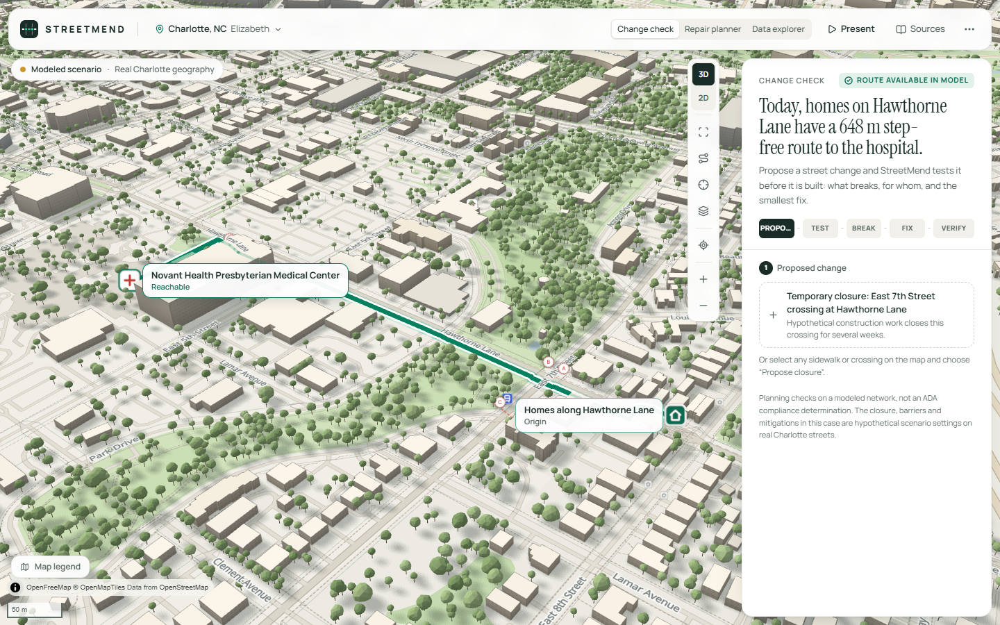
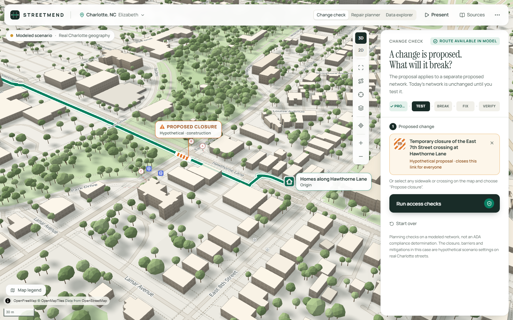
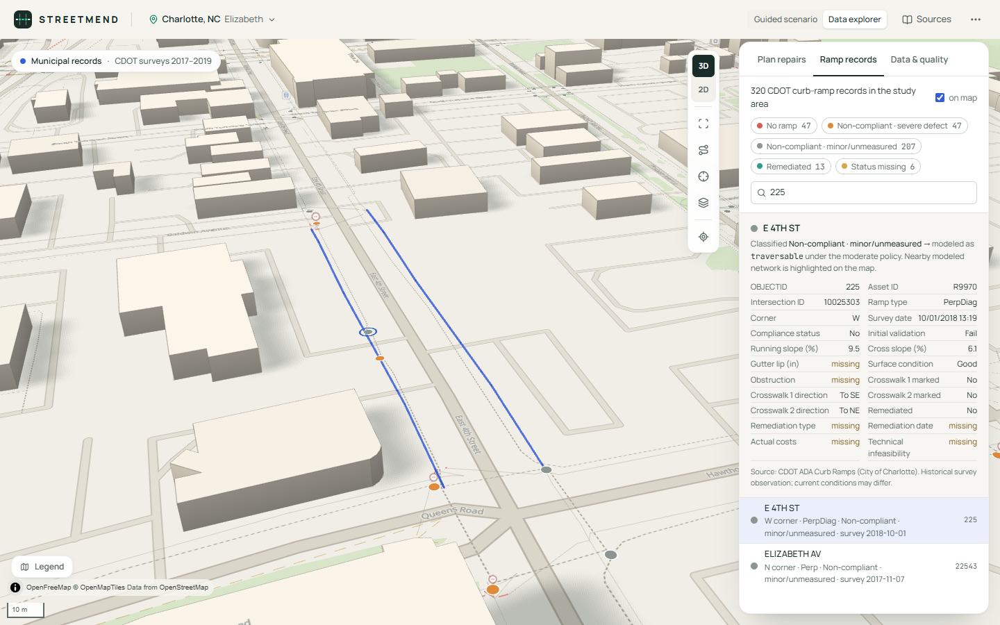

# STREETMEND

**Test the city before you change it.**

StreetMend is an **urban infrastructure verification** tool. A planner proposes a change to the street network: a sidewalk or crossing closed for construction, a removed connection, a reopened segment. StreetMend then works through five steps:

1. It builds the proposed network next to today's.
2. It runs explicit access checks on both.
3. It finds the journeys the change would break, and shows a graph counterexample of exactly why.
4. It searches for the smallest set of mitigations that fixes them.
5. It re-runs the checks on the fixed network before calling anything resolved.

**PROPOSE → TEST → FIND BREAKAGE → GENERATE FIX → VERIFY**

It runs on the real street geometry of Elizabeth in Charlotte, NC, shown as a 3D city built from OpenStreetMap footprints.

Built for IEEE Hack for Humanity 2026, track *Geospatial Intelligence for Action*.


> Planning and research prototype. The checks are configurable planning checks on a modeled network: not a certified accessible-navigation system, not an ADA compliance determination, and not an authorization to conduct construction. The City of Charlotte has not reviewed or endorsed it. The change-check case uses hypothetical proposals and barriers on real streets.

---

## The problem

Cities change physical infrastructure all the time: construction closures, intersection rebuilds, crossing redesigns, temporary diversions. The consequences are not visible at the work site. A closure can remove the **last modeled route** to a clinic for someone several blocks away, and the same closure affects people differently:

* someone who can step down a curb may still have a route;
* someone who needs a continuous step-free path may have lost their only one.

The city needs to know this **before** the change is made.

## What StreetMend does

| | |
|---|---|
| **Network digital twin** | Real Charlotte geometry: the Elizabeth pedestrian graph of corners, curb landings, crossings and sidewalk sides, inside a 3D city of 5,113 OSM buildings. Every edge has an explicit state (traversable / blocked / unknown) and an evidence label. The same graph is read under two travel profiles. **Step-free**: a missing curb ramp is a barrier. **Walking**: a curb can be stepped. Closures and legs with no usable crossing stop both. |
| **Change Studio** | Proposals are typed, validated operations (`close`, `reopen`) on real edges, applied to a separate *proposed* network state; today's network is never modified. Pick a prepared proposal, or select any sidewalk or crossing on the map and choose **Propose closure**. |
| **Access verification** | Configurable requirements, each checked on today's and the proposed network:<br>• a route within a threshold, for a profile;<br>• a detour limit;<br>• access to a destination category (for example a bus stop);<br>• a share of today's journeys kept.<br>Every check returns **PASS / FAIL / INCONCLUSIVE**. It is evaluated with unknown links excluded and with them included, so unknown data can make a result inconclusive but **never silently passes**. |
| **Counterexamples** | For each regression StreetMend shows:<br>• the origin and destination;<br>• today's route and the exact edge the proposal removes;<br>• the walking route that still exists and the curb steps that make it not step-free;<br>• the shortest step-free alternative and why it fails;<br>• the assumptions behind the result. |
| **Minimal-fix synthesis** | An exact search, by increasing size, over a catalog of typed mitigations: temporary curb ramps, temporary accessible crossings, ramp reconstruction. The closure itself stays in place. A set counts as a fix only when the graph engine verifies that every regressed check passes and nothing that passed starts failing. StreetMend also explains why every smaller set fails. No language model decides whether a fix works. |
| **Repair planner and data explorer** | Kept from the original StreetMend:<br>• **Repair planner**: finds the combination of repairs that reconnects the most journeys, compared with greedy and ranking baselines.<br>• **Data explorer**: 320 real CDOT curb-ramp records, sidewalk inventory and CATS bus stops, with record-level detail and data-quality reporting. |

### The change check, measured (not asserted)

All numbers come from the engine and are re-derived in `services/api/tests/test_verify.py`.

1. **Today:** homes on Hawthorne Lane have a **648 m** step-free route to Novant Health Presbyterian. All 5 checks pass.
2. **Proposal:** a hypothetical construction closure of the East 7th Street crossing at Hawthorne Lane.
3. **Regression:**
   * **3 checks FAIL**: the step-free route within 800 m, the 15% detour limit, and keeping 90% of the area's step-free journeys. Step-free journeys fall from 55 to 44 of 84.
   * Walkers keep a 648 m route through the other crossing, but it steps **2 curbs without ramps**.
   * The shortest step-free alternative is **868 m** (+34%).
4. **Fix:** the search checks 20 candidate sets in about 0.4 s and finds **A + B**, temporary curb ramps at both ends of the other crossing, as the only minimal fix.
   * A alone or B alone: still no step-free route within 800 m.
   * C, a temporary crossing at Park Drive, restores a 774 m route but breaks the detour limit (+19%).
5. **Verified:** with A + B in place, all 5 checks pass again, with a 648 m step-free route and all 55 step-free journeys.
6. **Removing B** fails the checks again. Putting it back passes.

The scenario settings (the closure, the missing ramps on the other crossing and two legs without a usable crossing) are hypothetical and labeled as such. The streets, crossings, buildings and destinations are real. [`scripts/scenarios/explore_preflight.py`](scripts/scenarios/explore_preflight.py) shows how the detours were found on the real graph.

### The repair planner, measured

* **Guided case** (healthcare priority, budget 2): two hypothetical barrier ramps at one crossing are each worth **0** alone and **+123** together. Greedy and individual ranking recommend nothing.
* **Real Charlotte records** (moderate policy): two recorded barrier ramps, **R112391** and **R20741**, cut homes on East 5th Street off from Novant Health Presbyterian. Neither repair alone restores the route; with both, it is 775 m.
* **Strict policy, budget 2:** exact search gains +186 against +53 for greedy.

Full tables: [docs/BENCHMARK.md](docs/BENCHMARK.md).

## Screenshots

**Change check**: propose, test, find the breakage, fix, verify.

| Today: route available | Proposal: a hypothetical closure | Regression and counterexample |
|---|---|---|
|  |  |  |
| **Minimal fix, and why not fewer** | **Applied and verified** | **The opening: United States → Charlotte** |
|  |  |  |

**Repair planner** and **data explorer**:

| Recommendation: A + B | Repair B: route reconnected | A real CDOT record |
|---|---|---|
|  |  |  |

More: [3D city](screenshots/04-city-3d.png) · [Elizabeth and Uptown](screenshots/10-city-wide.png) · [heal effect](screenshots/15-heal.png) · [before/after split](screenshots/08-before-after.png) · [data quality](screenshots/12-explorer-quality.png) · [phone](screenshots/13-mobile.png)

The demo video and the opening clip are in [docs/media/](docs/media/) (Playwright driving the real UI and engine, GPU-rendered).

## Architecture


* **Engine** (`services/api/streetmend`): Python, NetworkX for routing/inspection, SciPy compiled Dijkstra for batch evaluation, an exact key-node evaluator for fast combination scoring, Shapely/pyproj for geometry.
* **API**: FastAPI with Pydantic request/response models.
* **Web** (`apps/web`): React 19, TypeScript, Tailwind CSS v4, MapLibre GL JS with a Three.js custom layer, d3-geo + us-atlas for the opening, Motion, Zustand. Type: Manrope and Instrument Serif.
* **AI**: rule parser plus an optional Ollama model behind a Pydantic allowlist; grounding check on any model-written sentence (standalone numbers, number words and magnitude words must appear in the computed facts).

Details: [ARCHITECTURE.md](ARCHITECTURE.md) · Method: [METHODOLOGY.md](METHODOLOGY.md) · Data: [DATA_SOURCES.md](DATA_SOURCES.md) · Limits: [LIMITATIONS.md](LIMITATIONS.md)

## Run it

Requirements: Python 3.12+ with [uv](https://docs.astral.sh/uv/), Node.js 20+, a WebGL2 browser. Optional: [Ollama](https://ollama.com) with `qwen3:4b` for the language-model fallback.

```bash
# 1. API (from the repo root)
cd services/api
uv sync
uv run uvicorn streetmend.api.main:app --port 8000
```

```bash
# 2. Web app (second terminal, from the repo root)
cd apps/web
npm install
npm run dev
```

On Windows you can start both at once with `powershell -ExecutionPolicy Bypass -File scripts/dev.ps1`.

Open http://localhost:5173. The Charlotte network data, the guided-scenario spec and the building footprints are committed under `data/`, so the engine needs no network access. The basemap tiles and label fonts load from OpenFreeMap; offline, the 3D buildings, network, routes and markers still render on a plain background.

Without Ollama, the assistant runs on the rule parser only. To use a different model or endpoint, see [.env.example](.env.example).

### Re-fetch the data (optional)

```bash
uv run --project services/api --extra ingest python scripts/ingest/fetch_charlotte.py --refresh
uv run --project services/api --extra ingest python scripts/ingest/fetch_buildings.py
uv run --project services/api --extra ingest python scripts/ingest/fetch_trees.py
```

## Demo

Follow [DEMO_SCRIPT.md](DEMO_SCRIPT.md) for the 90–120 second live demo. The app opens in **Change check** mode (a first visit starts with a 4-second flight from the United States to Elizabeth). **Present** runs six acts on the live engine:

1. **A city that works**: a 648 m step-free route to the hospital, in emerald.
2. **A planner proposes a change**: a hypothetical closure of the East 7th Street crossing, drawn as a barricade on the proposed network only.
3. **StreetMend finds a regression**: **ACCESS REGRESSION DETECTED**. Today's route is ghosted and the counterexample shows the closure; walkers still pass at the other crossing by stepping two curbs.
4. **StreetMend finds a fix**: "Two coordinated interventions restore the required journey", with why each one alone, and option C, fail.
5. **Apply and verify**: the fix is applied, the original checks run again: **ACCESS RESTORED — CHECK PASSED**, with today / proposed / fixed metrics.
6. **The engine is real**: switch B off and the checks fail again; switch it back on and they pass.

## Tests

```bash
cd services/api && uv run pytest          # 134 tests: verification engine, optimizer, scenarios, API, assistant, municipal builder, ingestion
cd apps/web && npx playwright test        # 18 E2E tests against the real API (see below)
uv run --project services/api python scripts/benchmarks/run_benchmark.py   # regenerates docs/BENCHMARK.md
```

The Python suite covers:
* The change check, act by act:
  * the baseline passes and the closure regresses step-free access but not walking access;
  * the counterexample names the closure and the two curb steps;
  * A + B is the only minimal fix: every single candidate and every other pair is re-checked independently;
  * removing either intervention fails again.
* The three-valued logic on a hand-built network: an unknown detour is INCONCLUSIVE, never PASS. Plus typed-change validation and baseline immutability.
* Exact search against brute force (NetworkX reference).
* The fast evaluator against full Dijkstra on every subset.
* The dependent-pair synergy case, on the synthetic district and on the guided scenario.
* Unknown edges excluded from traversability, plus budget limits, undo/reset, and determinism.
* Builder invariants (no direct corner-to-corner links, WGS84 bounds, candidates only from recorded barrier ramps).
* Ingestion pagination, reprojection and failure handling.

The Playwright suite drives the change check end to end. Every check status, the counterexample and the fix are compared with the API's own answers. Then it runs the six presentation acts.

It also runs the repair planner's full 20-step flow:
1. Open the Charlotte map, switch 2D/3D, rotate and zoom.
2. Select the journey and inspect the blocked crossing from its map marker.
3. Analyze with a budget of two.
4. Apply A (still disconnected), then B (reconnected); the route length is checked against `/evaluate`.
5. Use the before/after split, undo, and reset.
6. Open a real CDOT record and check it field-by-field against `/municipal/records`.
7. Return to the guided scenario.

It also checks:
* The Three.js and MapLibre projections agree within 0.5 px at several pitches, bearings and zooms.
* A budget of one recommends nothing.
* The six presentation steps, the assistant allowlist and keyboard operation.
* The explorer's real-data dependency and policy switch.
* The phone layout.
* axe scans with no serious or critical findings.
* The opening:
  * the highlighted state's geometry contains Charlotte and Raleigh, not Columbia SC or Richmond VA;
  * the flight lands on the study area in 3D, with the city aligned;
  * skip and replay work;
  * a return visit gets the short version, and reduced motion gets no movement.

## Repository layout

```
apps/web/              React + MapLibre + Three.js frontend, Playwright E2E (e2e/), capture, axe and demo-recording scripts
  src/map/three/       3D city layer: camera bridge, footprint extrusion, network lines, marker sprites
  src/intro/           USA → Charlotte opening: national geometry and the camera timeline
  src/components/panel/ChangeCheck.tsx   the change-check flow: proposal, checks, counterexample, fix, verification
services/api/          Python package `streetmend`: graph, scenario, verify (change checks), optimize, municipal, ai, api + pytest suite
data/samples/          Prepared Charlotte (Elizabeth) study-area data and city building footprints, with provenance
data/scenarios/        Guided-scenario spec (hypothetical barrier states on real streets)
scripts/ingest/        Reproducible Charlotte, OSM and building ingestion
scripts/scenarios/     Designer that searched the real graph for the guided scenario's dependent pair
scripts/benchmarks/    Benchmark generating docs/BENCHMARK.md
docs/                  Architecture diagram, benchmark, demo video
screenshots/           README screenshots
```

## Roadmap (not implemented)

* Field-verification workflow to turn UNKNOWN links into evidence.
* Cost-aware budgets once credible per-ramp cost estimates exist (the CDOT `ActualCosts` field is empty for all 320 study-area records).
* Signal timing and crossing-risk modeling; population-weighted origins from census data.
* Citywide processing with tiled graph builds; measured building heights (for example from city LiDAR) in place of estimates.

## Attribution

* **Charlotte Department of Transportation**: ADA Curb Ramps and Sidewalk Inventory; **CATS / City of Charlotte**: bus stops. City of Charlotte open data.
* **OpenStreetMap contributors**: street network, destinations and building footprints (ODbL 1.0). Basemap © OpenMapTiles, served by OpenFreeMap.
* Libraries: NetworkX, SciPy, NumPy, Shapely, pyproj, OSMnx, GeoPandas, FastAPI, Pydantic, React, MapLibre GL JS, three.js, Tailwind CSS, Motion, Zustand, lucide-react, Playwright, axe-core.
* **AskStreets** by Adam Munawar Rahman ([github.com/msradam/askstreets](https://github.com/msradam/askstreets)) inspired the idea of asking natural-language questions of street networks. StreetMend is an independent implementation with a different objective (repair-combination optimization) and no AskStreets code.

Code: MIT (see [LICENSE](LICENSE)). Data files keep their source licenses.
