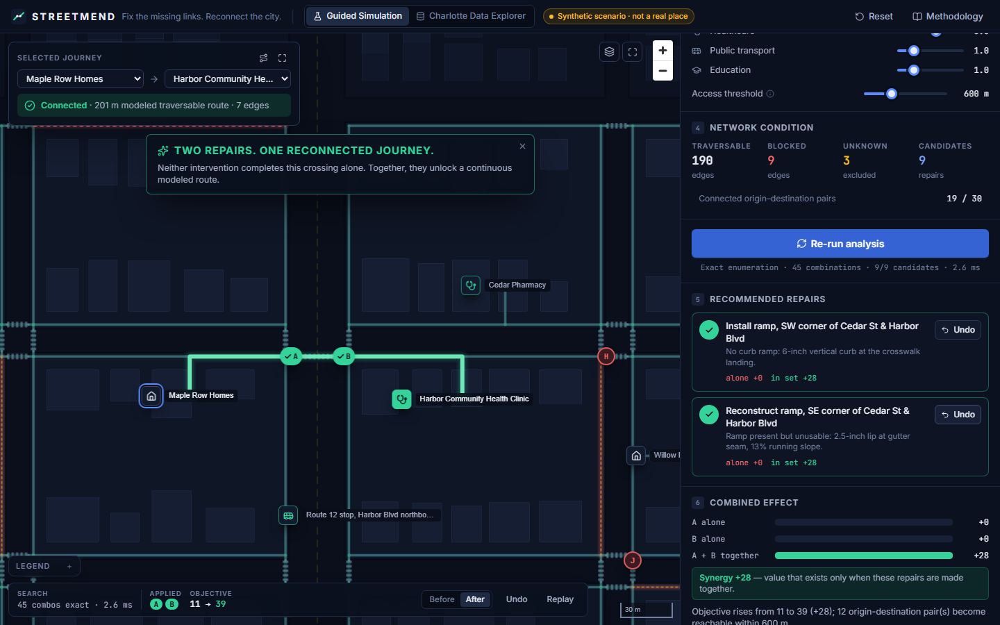
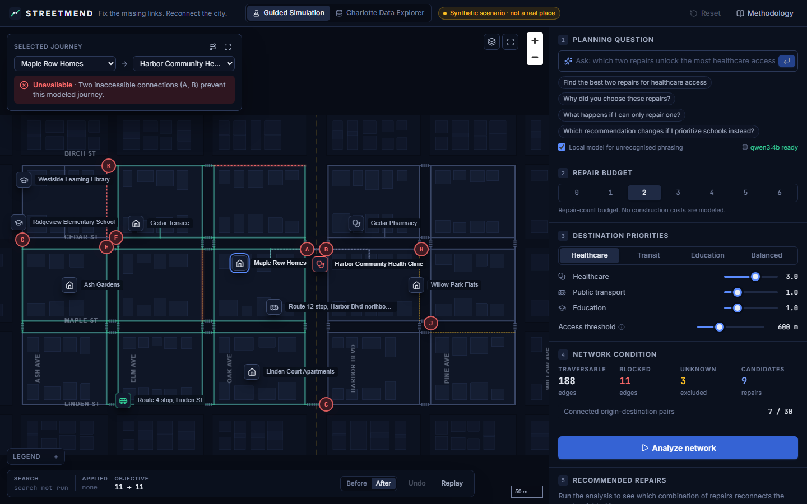
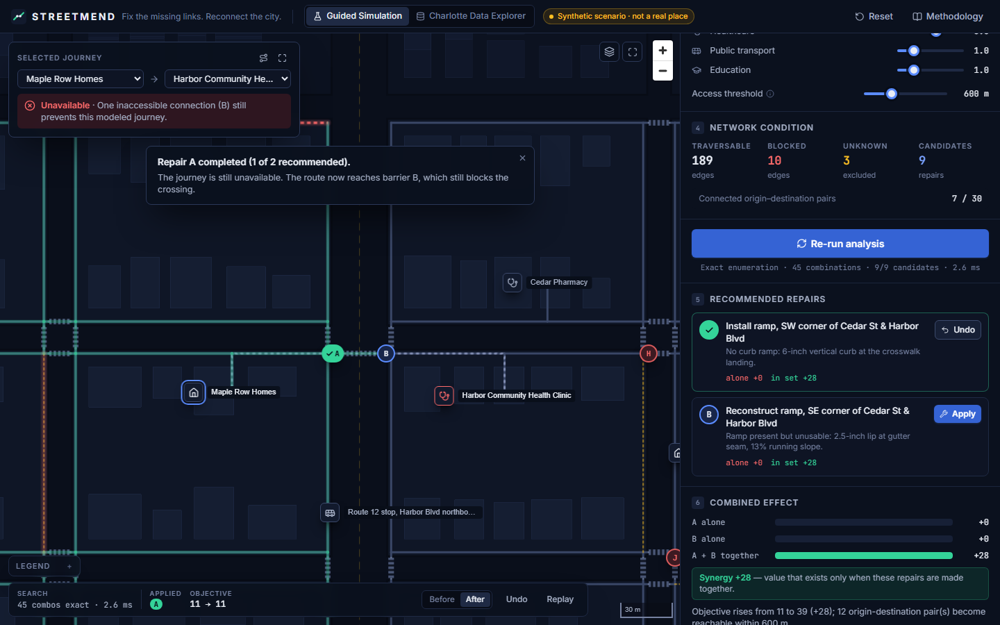
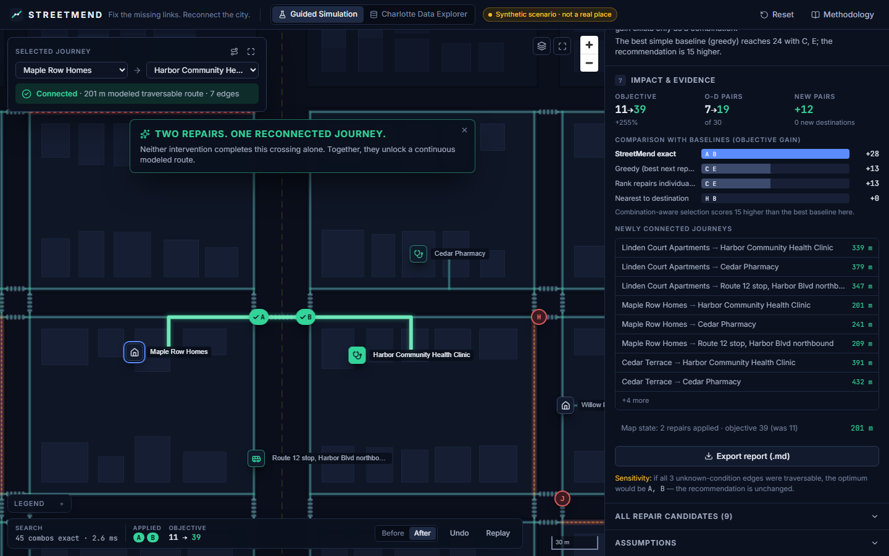
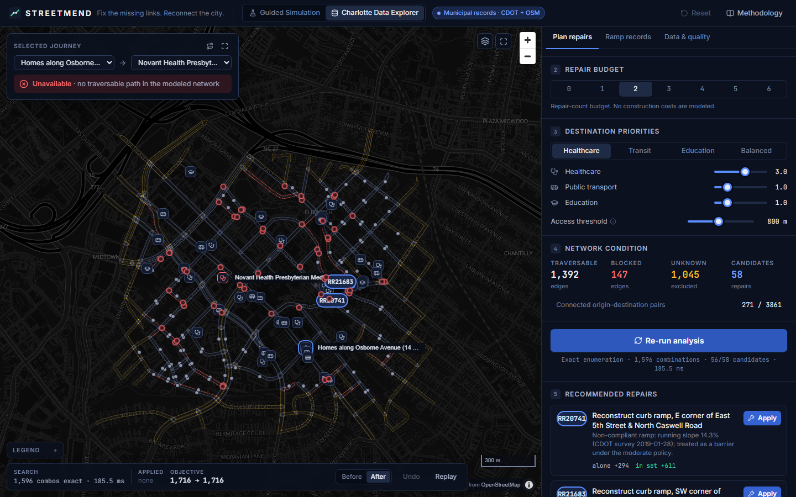
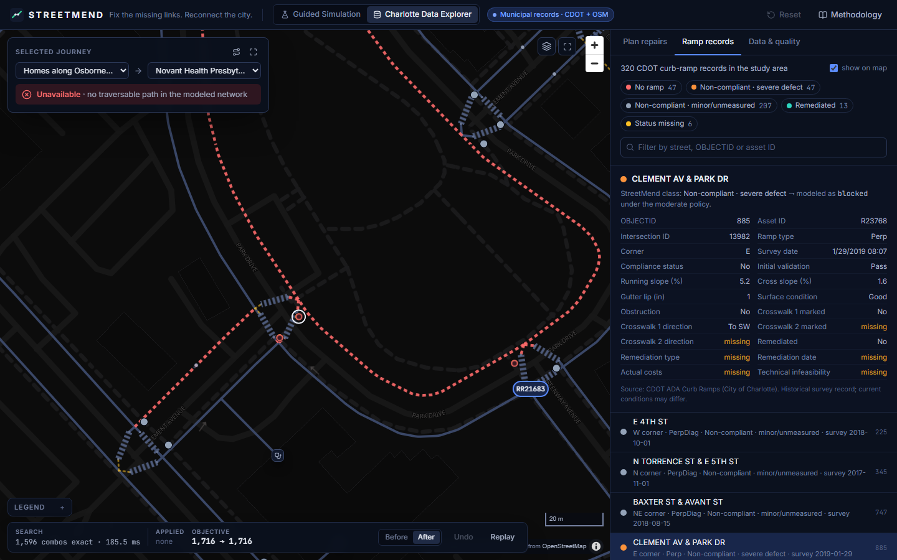

# STREETMEND

**Fix the missing links. Reconnect the city.**

StreetMend is a geospatial decision-support tool for pedestrian accessibility repairs. It models a street network as a graph of sidewalk corners, curb-ramp landings and crossings, simulates repairs, and recommends the **combination** of repairs that reconnects the most weighted journeys to essential services under a limited budget.

Built for IEEE Hack for Humanity 2026, track *Geospatial Intelligence for Action*.



> Planning and research prototype. Not a certified accessible-navigation system, not an ADA compliance determination, and not an authorization to conduct construction. The City of Charlotte has not reviewed or endorsed it.

---

## The problem

A wheelchair user can cross a street only if the curb ramps at **both** ends of the crossing are usable. Ranking barriers one at a time misses this. Repairing one missing ramp may change nothing, while repairing it together with the ramp across the street opens a whole route.

So the planning question is not "which ramp is worst?" but:

> *Given a limited number of repairs, which combination produces the greatest measurable improvement in access to essential destinations?*

## What StreetMend does

| | |
|---|---|
| **Pedestrian graph** | Corners, curb landings, crossings and sidewalk sides. Every edge has an explicit state (traversable / blocked / unknown) and an evidence label (synthetic, municipal record, historical survey, OSM, inferred, assumed). Corners on different sides of a street connect only through a crossing with ramps at both ends. |
| **Combination-aware optimization** | Exact enumeration of every repair set within the budget (optimal for the stated candidate set and objective), plus greedy, individual-ranking and nearest-to-destination baselines. Beam search for very large candidate sets, always labeled approximate. |
| **Evidence, not decoration** | Every route on the map is a real graph path, every number is computed by the engine, and synergy is measured explicitly: each repair's gain alone, its marginal value within the set, and newly connected origin–destination pairs. |
| **Two operating modes** | **Guided Simulation**: a synthetic district built to demonstrate the dependent-repair problem; works fully offline. **Charlotte Data Explorer**: real CDOT curb-ramp and sidewalk records, CATS bus stops and OpenStreetMap streets/destinations for the Elizabeth neighborhood. |
| **Natural-language questions** | "Which two repairs improve access to healthcare the most?" A deterministic rule parser handles common phrasing; unrecognized phrasing can go to a local model (Ollama, `qwen3:4b`) that may only choose one allowlisted operation with validated arguments. The model never computes routes or scores; optional model wording is rejected if it contains any number or magnitude word not in the computed facts. |

### Why combinations matter (measured, not asserted)

* Guided scenario, healthcare priority, budget 2: **exact +28** vs greedy +13 / individual ranking +13. Repairs A and B are each worth **0** alone and **+28** together. (Designed to illustrate the effect, so it is not evidence of typical gains.)
* **Real Charlotte data**: homes along East 5th Street cannot reach Novant Health Presbyterian Medical Center within 800 m. Two recorded barrier ramps block the route: **R112391** (worth 0 on its own) and **R20741**. With both repaired, the route is 775 m.
* Charlotte under the strict policy, budget 2: **exact +186 vs greedy +53**. Under the moderate and lenient policies, greedy already matches the optimum.
* 40 randomized districts: greedy is optimal in most instances (mean 97% of optimum, worst 32%). 40 unstructured grids: greedy falls below the optimum in 20–26% of instances.

Full tables: [docs/BENCHMARK.md](docs/BENCHMARK.md). The honest conclusion: simple ranking is often fine, but it fails badly exactly when value exists only in combination, and StreetMend detects and explains those cases.

## Screenshots

| Disconnected journey | Recommendation | First repair: still blocked |
|---|---|---|
|  |  |  |
| **Evidence and baselines** | **Charlotte: planning on real records** | **Charlotte: ramp record detail** |
|  |  |  |

A 73-second screen capture of the working app is in [docs/media/streetmend-demo.mp4](docs/media/streetmend-demo.mp4) (recorded with Playwright driving the real UI; no mock data).

## Architecture


* **Engine** (`services/api/streetmend`): Python, NetworkX for routing/inspection, SciPy compiled Dijkstra for batch evaluation, an exact key-node evaluator for fast combination scoring, Shapely/pyproj for geometry.
* **API**: FastAPI with Pydantic request/response models.
* **Web** (`apps/web`): React 19, TypeScript, Tailwind CSS v4, MapLibre GL JS (WebGL layers), Motion, Zustand.
* **AI**: rule parser plus an optional Ollama model behind a Pydantic allowlist; grounding check on any model-written sentence (standalone numbers, number words and magnitude words must appear in the computed facts).

Details: [ARCHITECTURE.md](ARCHITECTURE.md) · Method: [METHODOLOGY.md](METHODOLOGY.md) · Data: [DATA_SOURCES.md](DATA_SOURCES.md) · Limits: [LIMITATIONS.md](LIMITATIONS.md)

## Run it

Requirements: Python 3.12+ with [uv](https://docs.astral.sh/uv/), Node.js 20+. Optional: [Ollama](https://ollama.com) with `qwen3:4b` for the language-model fallback.

```bash
# 1. API (from the repo root)
cd services/api
uv sync
uv run uvicorn streetmend.api.main:app --port 8000
```

```bash
# 2. Web app (second terminal, from the repo root)
cd apps/web
npm install
npm run dev
```

On Windows you can start both at once with `powershell -ExecutionPolicy Bypass -File scripts/dev.ps1`.

Open http://localhost:5173. The Charlotte data for the study area is committed under `data/samples/`, so no network access is needed for either mode (basemap tiles in the Charlotte view load from OpenFreeMap when online; the network layers still render offline).

Without Ollama, the assistant runs on the rule parser only. To use a different model or endpoint, see [.env.example](.env.example).

### Re-fetch the Charlotte data (optional)

```bash
uv run --project services/api --extra ingest python scripts/ingest/fetch_charlotte.py --refresh
```

## Demo

Follow [DEMO_SCRIPT.md](DEMO_SCRIPT.md) for the 90–120 second live demo.

1. **Act 1**: Maple Row Homes → clinic is *Unavailable: two inaccessible connections (A, B)*.
2. **Act 2**: Ask *"Find the best two repairs for healthcare access"*. The exact search selects A + B.
3. **Act 3**: Apply A. The reach wave crosses the street and stops at B; the journey is still unavailable.
4. **Act 4**: Apply B. The route traces through both repairs: **TWO REPAIRS. ONE RECONNECTED JOURNEY.**
5. **Act 5**: Evidence: objective 11 → 39, 12 newly connected pairs, baselines +13.
6. **Act 6**: Change budget or priority; recommendations recompute. Then switch to Charlotte.

## Tests

```bash
cd services/api && uv run pytest          # 115 tests: engine, optimizer, API, assistant, municipal builder, ingestion
cd apps/web && npx playwright test        # 8 E2E tests: full demo flow, recomputation, Charlotte explorer, keyboard, axe scan
uv run --project services/api python scripts/benchmarks/run_benchmark.py   # regenerates docs/BENCHMARK.md
```

The suites cover:
* Exact search against brute force (NetworkX reference).
* The fast evaluator against full Dijkstra on every subset.
* The dependent-pair synergy case (A alone and B alone unlock nothing; A + B do).
* Unknown edges excluded from traversability, plus budget limits, undo/reset, and determinism.
* Builder invariants (no direct corner-to-corner links, WGS84 bounds, candidates only from recorded barrier ramps).
* Ingestion pagination, reprojection and failure handling.

## Repository layout

```
apps/web/              React + MapLibre frontend, Playwright E2E (e2e/), capture & demo-recording scripts
services/api/          Python package `streetmend`: graph, scenario, optimize, municipal, ai, api + pytest suite
data/samples/          Prepared Charlotte (Elizabeth) study-area data with provenance and quality reports
scripts/ingest/        Reproducible Charlotte + OSM ingestion
scripts/benchmarks/    Benchmark generating docs/BENCHMARK.md
docs/                  Architecture diagram, benchmark, demo video
screenshots/           README screenshots
```

## Roadmap (not implemented)

* Field-verification workflow to turn UNKNOWN links into evidence.
* Cost-aware budgets once credible per-ramp cost estimates exist (the CDOT `ActualCosts` field is empty for all 320 study-area records).
* Signal timing and crossing-risk modeling; population-weighted origins from census data.
* Citywide processing with tiled graph builds.

## Attribution

* **Charlotte Department of Transportation**: ADA Curb Ramps and Sidewalk Inventory; **CATS / City of Charlotte**: bus stops. City of Charlotte open data.
* **OpenStreetMap contributors**: street network, destinations and buildings (ODbL 1.0). Basemap © OpenMapTiles via OpenFreeMap.
* Libraries: NetworkX, SciPy, NumPy, Shapely, pyproj, OSMnx, GeoPandas, FastAPI, Pydantic, React, MapLibre GL JS, Tailwind CSS, Motion, Zustand, lucide-react, Playwright, axe-core.
* **AskStreets** by Adam Munawar Rahman ([github.com/msradam/askstreets](https://github.com/msradam/askstreets)) inspired the idea of asking natural-language questions of street networks. StreetMend is an independent implementation with a different objective (repair-combination optimization) and no AskStreets code.

Code: MIT (see [LICENSE](LICENSE)). Data files keep their source licenses.
